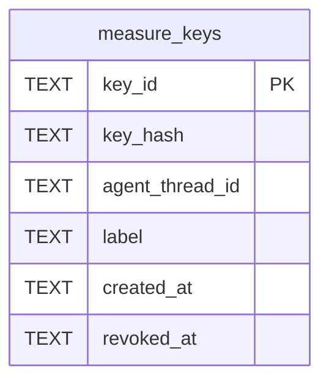

# Measure Keys Schema

Tables in the primary store created by `backend/infra/measure_keys_schema.py`.

## Tables 1–1

### `measure_keys`

| Column | Type | Primary key | NOT NULL | Default | References ||---|---|---|---|---|---|
| `key_id` | TEXT | Yes | No | — | — |
| `key_hash` | TEXT | No | Yes | — | — |
| `agent_thread_id` | TEXT | No | Yes | — | — |
| `label` | TEXT | No | Yes | — | — |
| `created_at` | TEXT | No | Yes | — | — |
| `revoked_at` | TEXT | No | No | — | — |

Indexes: `idx_measure_keys_agent` (agent_thread_id, created_at), `sqlite_autoindex_measure_keys_1` (key_id, unique), `sqlite_autoindex_measure_keys_2` (key_hash, unique).
