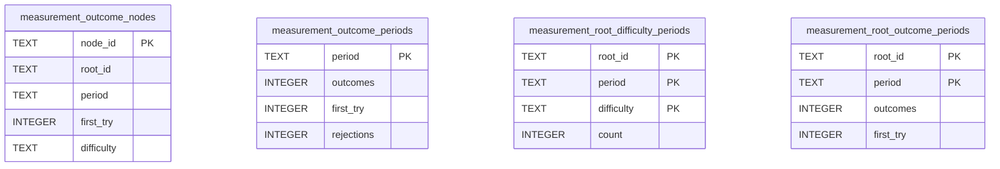
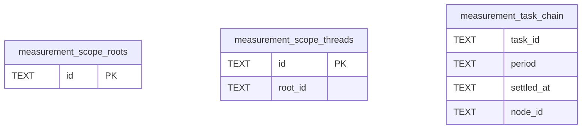

# Measurement Prepared

Temporary tables on a primary database connection created by `backend/api/measurement_prepared.py`.

## Tables 1–4

### `measurement_outcome_nodes`

| Column | Type | Primary key | NOT NULL | Default | References ||---|---|---|---|---|---|
| `node_id` | TEXT | Yes | No | — | — |
| `root_id` | TEXT | No | Yes | — | — |
| `period` | TEXT | No | Yes | — | — |
| `first_try` | INTEGER | No | Yes | — | — |
| `difficulty` | TEXT | No | No | — | — |

Indexes: `sqlite_autoindex_measurement_outcome_nodes_1` (node_id, unique).

### `measurement_outcome_periods`

| Column | Type | Primary key | NOT NULL | Default | References ||---|---|---|---|---|---|
| `period` | TEXT | Yes | No | — | — |
| `outcomes` | INTEGER | No | Yes | — | — |
| `first_try` | INTEGER | No | Yes | — | — |
| `rejections` | INTEGER | No | Yes | — | — |

Indexes: `sqlite_autoindex_measurement_outcome_periods_1` (period, unique).

### `measurement_root_difficulty_periods`

| Column | Type | Primary key | NOT NULL | Default | References ||---|---|---|---|---|---|
| `root_id` | TEXT | Yes | Yes | — | — |
| `period` | TEXT | Yes | Yes | — | — |
| `difficulty` | TEXT | Yes | Yes | — | — |
| `count` | INTEGER | No | Yes | — | — |

Indexes: `sqlite_autoindex_measurement_root_difficulty_periods_1` (root_id, period, difficulty, unique).

### `measurement_root_outcome_periods`

| Column | Type | Primary key | NOT NULL | Default | References ||---|---|---|---|---|---|
| `root_id` | TEXT | Yes | Yes | — | — |
| `period` | TEXT | Yes | Yes | — | — |
| `outcomes` | INTEGER | No | Yes | — | — |
| `first_try` | INTEGER | No | Yes | — | — |

Indexes: `sqlite_autoindex_measurement_root_outcome_periods_1` (root_id, period, unique).

## Tables 5–7

### `measurement_scope_roots`

| Column | Type | Primary key | NOT NULL | Default | References ||---|---|---|---|---|---|
| `id` | TEXT | Yes | No | — | — |

Indexes: `sqlite_autoindex_measurement_scope_roots_1` (id, unique).

### `measurement_scope_threads`

| Column | Type | Primary key | NOT NULL | Default | References ||---|---|---|---|---|---|
| `id` | TEXT | Yes | No | — | — |
| `root_id` | TEXT | No | No | — | — |

Indexes: `sqlite_autoindex_measurement_scope_threads_1` (id, unique).

### `measurement_task_chain`

| Column | Type | Primary key | NOT NULL | Default | References ||---|---|---|---|---|---|
| `task_id` | TEXT | No | No | — | — |
| `period` | TEXT | No | No | — | — |
| `settled_at` | TEXT | No | No | — | — |
| `node_id` | TEXT | No | No | — | — |

Indexes: None.
