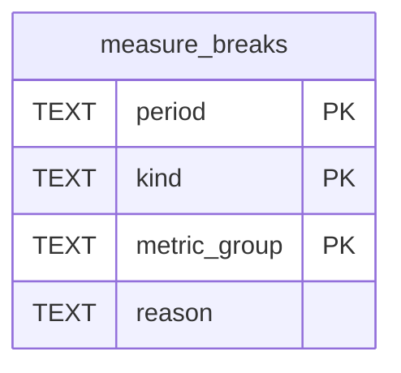

# Measurement Schema

Tables in the primary store created by `backend/infra/measurement_schema.py`.

## Tables 1–1

### `measure_breaks`

| Column | Type | Primary key | NOT NULL | Default | References ||---|---|---|---|---|---|
| `period` | TEXT | Yes | Yes | — | — |
| `kind` | TEXT | Yes | Yes | — | — |
| `metric_group` | TEXT | Yes | No | — | — |
| `reason` | TEXT | No | Yes | — | — |

Indexes: `idx_measure_break_starts_group` (metric_group, unique), `idx_measure_breaks_identity` (period, kind, expression, unique), `sqlite_autoindex_measure_breaks_1` (period, kind, metric_group, unique).
