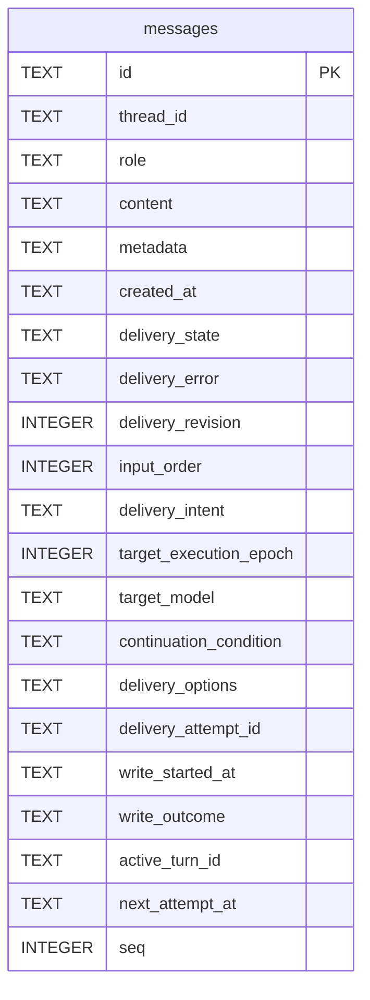

# Message Schema

Tables in the primary store created by `backend/infra/message_schema.py`.

## Tables 1–1

### `messages`

| Column | Type | Primary key | NOT NULL | Default | References ||---|---|---|---|---|---|
| `id` | TEXT | Yes | No | — | — |
| `thread_id` | TEXT | No | Yes | — | threads.id |
| `role` | TEXT | No | Yes | — | — |
| `content` | TEXT | No | Yes | — | — |
| `metadata` | TEXT | No | No | — | — |
| `created_at` | TEXT | No | Yes | — | — |
| `delivery_state` | TEXT | No | Yes | 'delivered' | — |
| `delivery_error` | TEXT | No | No | — | — |
| `delivery_revision` | INTEGER | No | Yes | 1 | — |
| `input_order` | INTEGER | No | No | — | — |
| `delivery_intent` | TEXT | No | No | — | — |
| `target_execution_epoch` | INTEGER | No | No | — | — |
| `target_model` | TEXT | No | No | — | — |
| `continuation_condition` | TEXT | No | No | — | — |
| `delivery_options` | TEXT | No | No | — | — |
| `delivery_attempt_id` | TEXT | No | No | — | — |
| `write_started_at` | TEXT | No | No | — | — |
| `write_outcome` | TEXT | No | No | — | — |
| `active_turn_id` | TEXT | No | No | — | — |
| `next_attempt_at` | TEXT | No | No | — | — |
| `seq` | INTEGER | No | No | — | — |

Indexes: `idx_measurement_human_messages_time` (thread_id, created_at, id), `idx_messages_active_turn` (active_turn_id, input_order), `idx_messages_checkpoint_hold` (thread_id, target_model, target_execution_epoch), `idx_messages_delivery_attempt` (delivery_attempt_id, input_order), `idx_messages_id_session` (id, thread_id, unique), `idx_messages_input_order` (thread_id, input_order, unique), `idx_messages_installed_boundaries` (thread_id, seq, id), `idx_messages_queued_inputs` (thread_id, delivery_state, input_order), `idx_messages_session` (thread_id, created_at), `idx_messages_session_seq` (thread_id, seq, unique), `idx_messages_tool_lineage` (thread_id, role, expression, expression), `idx_messages_turn_calls` (thread_id, role, expression), `sqlite_autoindex_messages_1` (id, unique).
