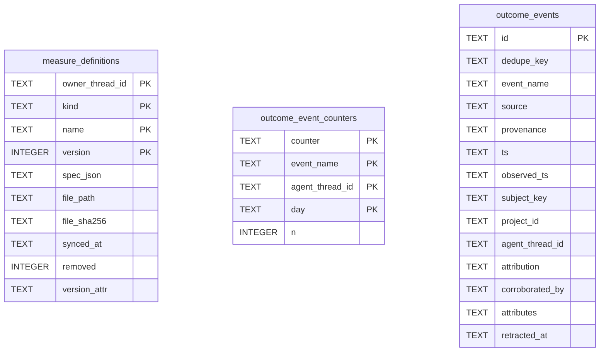

# Outcome Events Schema

Tables in the primary store created by `backend/infra/outcome_events_schema.py`.

## Tables 1–3

### `measure_definitions`

| Column | Type | Primary key | NOT NULL | Default | References ||---|---|---|---|---|---|
| `owner_thread_id` | TEXT | Yes | Yes | — | — |
| `kind` | TEXT | Yes | Yes | — | — |
| `name` | TEXT | Yes | Yes | — | — |
| `version` | INTEGER | Yes | Yes | — | — |
| `spec_json` | TEXT | No | Yes | — | — |
| `file_path` | TEXT | No | Yes | — | — |
| `file_sha256` | TEXT | No | Yes | — | — |
| `synced_at` | TEXT | No | Yes | — | — |
| `removed` | INTEGER | No | Yes | 0 | — |
| `version_attr` | TEXT | No | No | — | — |

Indexes: `idx_measure_definitions_kind_name` (kind, name), `sqlite_autoindex_measure_definitions_1` (owner_thread_id, kind, name, version, unique).

### `outcome_event_counters`

| Column | Type | Primary key | NOT NULL | Default | References ||---|---|---|---|---|---|
| `counter` | TEXT | Yes | Yes | — | — |
| `event_name` | TEXT | Yes | Yes | — | — |
| `agent_thread_id` | TEXT | Yes | Yes | '' | — |
| `day` | TEXT | Yes | Yes | '0000-00-00' | — |
| `n` | INTEGER | No | Yes | 0 | — |

Indexes: `sqlite_autoindex_outcome_event_counters_1` (agent_thread_id, day, event_name, counter, unique).

### `outcome_events`

| Column | Type | Primary key | NOT NULL | Default | References ||---|---|---|---|---|---|
| `id` | TEXT | Yes | No | — | — |
| `dedupe_key` | TEXT | No | Yes | — | — |
| `event_name` | TEXT | No | Yes | — | — |
| `source` | TEXT | No | Yes | — | — |
| `provenance` | TEXT | No | Yes | — | — |
| `ts` | TEXT | No | Yes | — | — |
| `observed_ts` | TEXT | No | Yes | — | — |
| `subject_key` | TEXT | No | No | — | — |
| `project_id` | TEXT | No | No | — | — |
| `agent_thread_id` | TEXT | No | No | — | — |
| `attribution` | TEXT | No | No | — | — |
| `corroborated_by` | TEXT | No | No | — | — |
| `attributes` | TEXT | No | Yes | — | — |
| `retracted_at` | TEXT | No | No | — | — |

Indexes: `idx_learning_loop_outcome_subject` (subject_key, unique), `idx_learning_loop_triage_subject` (subject_key, unique), `idx_measurement_size_rater` (expression, subject_key), `idx_outcome_events_agent_observed` (agent_thread_id, observed_ts, event_name), `idx_outcome_events_agent_ts` (agent_thread_id, ts), `idx_outcome_events_name_ts` (event_name, ts), `idx_outcome_events_project_ts` (project_id, ts), `idx_outcome_events_subject` (subject_key), `sqlite_autoindex_outcome_events_1` (id, unique), `sqlite_autoindex_outcome_events_2` (dedupe_key, unique).
