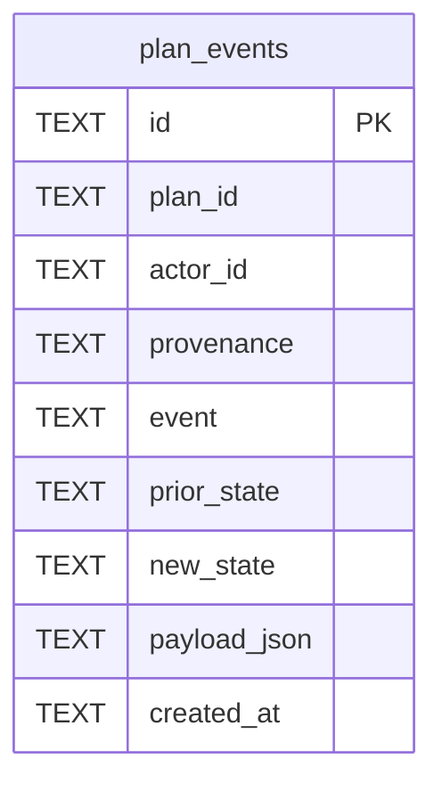

# Plan Events Schema

Tables in the primary store created by `backend/infra/plan_events_schema.py`.

## Tables 1–1

### `plan_events`

| Column | Type | Primary key | NOT NULL | Default | References ||---|---|---|---|---|---|
| `id` | TEXT | Yes | No | — | — |
| `plan_id` | TEXT | No | Yes | — | plans.id |
| `actor_id` | TEXT | No | No | — | — |
| `provenance` | TEXT | No | Yes | — | — |
| `event` | TEXT | No | Yes | — | — |
| `prior_state` | TEXT | No | No | — | — |
| `new_state` | TEXT | No | No | — | — |
| `payload_json` | TEXT | No | No | — | — |
| `created_at` | TEXT | No | Yes | — | — |

Indexes: `idx_plan_events_plan` (plan_id, created_at), `sqlite_autoindex_plan_events_1` (id, unique).
