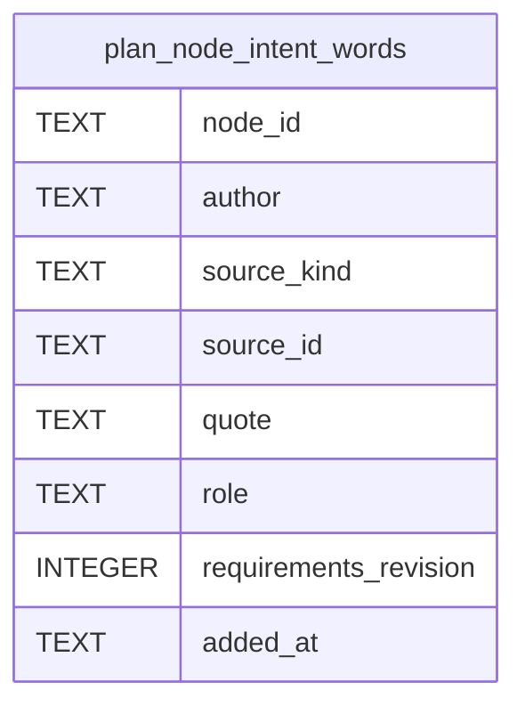

# Plan Intent Schema

Tables in the primary store created by `backend/infra/plan_intent_schema.py`.

## Tables 1–1

### `plan_node_intent_words`

| Column | Type | Primary key | NOT NULL | Default | References ||---|---|---|---|---|---|
| `node_id` | TEXT | No | Yes | — | plan_nodes.id |
| `author` | TEXT | No | Yes | — | — |
| `source_kind` | TEXT | No | Yes | — | — |
| `source_id` | TEXT | No | Yes | — | — |
| `quote` | TEXT | No | Yes | — | — |
| `role` | TEXT | No | Yes | — | — |
| `requirements_revision` | INTEGER | No | Yes | — | — |
| `added_at` | TEXT | No | Yes | — | — |

Indexes: `idx_plan_node_intent_words_node` (node_id).
