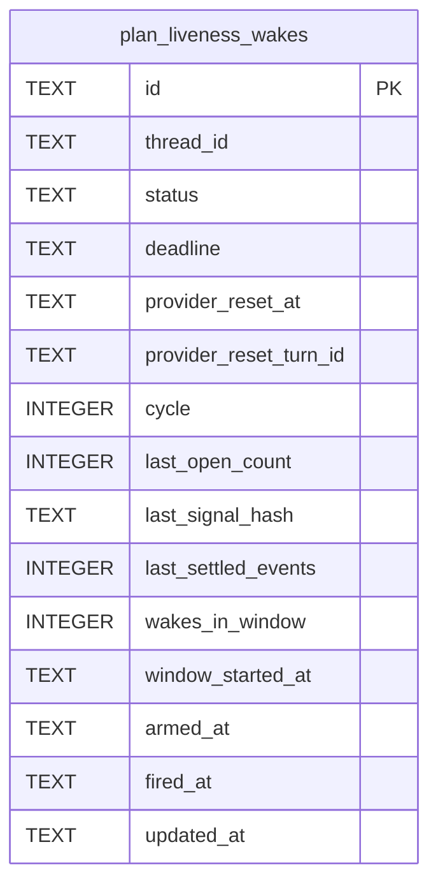

# Plan Liveness Schema

Tables in the primary store created by `backend/infra/plan_liveness_schema.py`.

## Tables 1–1

### `plan_liveness_wakes`

| Column | Type | Primary key | NOT NULL | Default | References ||---|---|---|---|---|---|
| `id` | TEXT | Yes | No | — | — |
| `thread_id` | TEXT | No | Yes | — | — |
| `status` | TEXT | No | Yes | 'armed' | — |
| `deadline` | TEXT | No | Yes | — | — |
| `provider_reset_at` | TEXT | No | No | — | — |
| `provider_reset_turn_id` | TEXT | No | No | — | — |
| `cycle` | INTEGER | No | Yes | 0 | — |
| `last_open_count` | INTEGER | No | Yes | 0 | — |
| `last_signal_hash` | TEXT | No | Yes | '' | — |
| `last_settled_events` | INTEGER | No | Yes | 0 | — |
| `wakes_in_window` | INTEGER | No | Yes | 0 | — |
| `window_started_at` | TEXT | No | No | — | — |
| `armed_at` | TEXT | No | Yes | — | — |
| `fired_at` | TEXT | No | No | — | — |
| `updated_at` | TEXT | No | Yes | — | — |

Indexes: `idx_plan_liveness_thread_status` (thread_id, status), `sqlite_autoindex_plan_liveness_wakes_1` (id, unique), `sqlite_autoindex_plan_liveness_wakes_2` (thread_id, unique).
