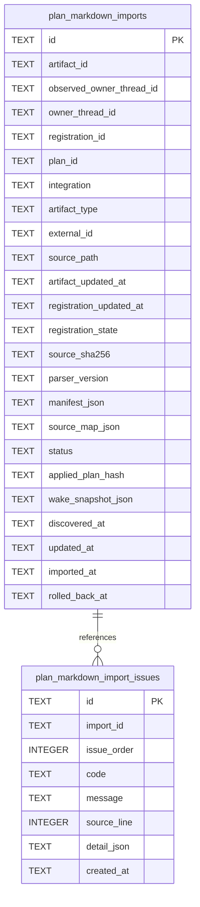

# Plan Markdown Import Schema

Tables in the primary store created by `backend/infra/plan_markdown_import_schema.py`.

## Tables 1–2

### `plan_markdown_import_issues`

| Column | Type | Primary key | NOT NULL | Default | References ||---|---|---|---|---|---|
| `id` | TEXT | Yes | No | — | — |
| `import_id` | TEXT | No | Yes | — | plan_markdown_imports.id |
| `issue_order` | INTEGER | No | Yes | — | — |
| `code` | TEXT | No | Yes | — | — |
| `message` | TEXT | No | Yes | — | — |
| `source_line` | INTEGER | No | No | — | — |
| `detail_json` | TEXT | No | No | — | — |
| `created_at` | TEXT | No | Yes | — | — |

Indexes: `idx_plan_markdown_import_issues_import` (import_id, issue_order), `sqlite_autoindex_plan_markdown_import_issues_1` (id, unique), `sqlite_autoindex_plan_markdown_import_issues_2` (import_id, issue_order, unique).

### `plan_markdown_imports`

| Column | Type | Primary key | NOT NULL | Default | References ||---|---|---|---|---|---|
| `id` | TEXT | Yes | No | — | — |
| `artifact_id` | TEXT | No | Yes | — | artifact_identities.id |
| `observed_owner_thread_id` | TEXT | No | No | — | — |
| `owner_thread_id` | TEXT | No | No | — | threads.id |
| `registration_id` | TEXT | No | No | — | — |
| `plan_id` | TEXT | No | No | — | — |
| `integration` | TEXT | No | Yes | — | — |
| `artifact_type` | TEXT | No | Yes | — | — |
| `external_id` | TEXT | No | Yes | — | — |
| `source_path` | TEXT | No | Yes | — | — |
| `artifact_updated_at` | TEXT | No | Yes | — | — |
| `registration_updated_at` | TEXT | No | No | — | — |
| `registration_state` | TEXT | No | No | — | — |
| `source_sha256` | TEXT | No | No | — | — |
| `parser_version` | TEXT | No | No | — | — |
| `manifest_json` | TEXT | No | No | — | — |
| `source_map_json` | TEXT | No | No | — | — |
| `status` | TEXT | No | Yes | — | — |
| `applied_plan_hash` | TEXT | No | No | — | — |
| `wake_snapshot_json` | TEXT | No | No | — | — |
| `discovered_at` | TEXT | No | Yes | — | — |
| `updated_at` | TEXT | No | Yes | — | — |
| `imported_at` | TEXT | No | No | — | — |
| `rolled_back_at` | TEXT | No | No | — | — |

Indexes: `idx_plan_markdown_imports_owner` (owner_thread_id, unique), `idx_plan_markdown_imports_status` (status), `sqlite_autoindex_plan_markdown_imports_1` (id, unique), `sqlite_autoindex_plan_markdown_imports_2` (artifact_id, unique), `sqlite_autoindex_plan_markdown_imports_3` (plan_id, unique).
