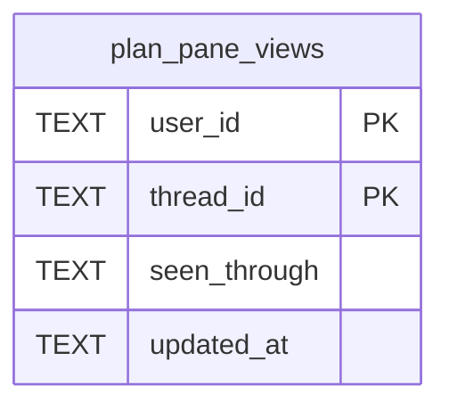

# Plan Pane Views Schema

Tables in the primary store created by `backend/infra/plan_pane_views_schema.py`.

## Tables 1–1

### `plan_pane_views`

| Column | Type | Primary key | NOT NULL | Default | References ||---|---|---|---|---|---|
| `user_id` | TEXT | Yes | Yes | — | — |
| `thread_id` | TEXT | Yes | Yes | — | threads.id |
| `seen_through` | TEXT | No | Yes | — | — |
| `updated_at` | TEXT | No | Yes | — | — |

Indexes: `sqlite_autoindex_plan_pane_views_1` (user_id, thread_id, unique).
