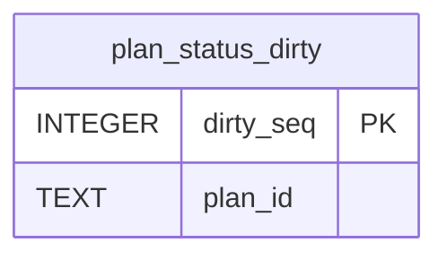

# Plan Status Schema

Tables in the primary store created by `backend/infra/plan_status_schema.py`.

## Tables 1–1

### `plan_status_dirty`

| Column | Type | Primary key | NOT NULL | Default | References ||---|---|---|---|---|---|
| `dirty_seq` | INTEGER | Yes | No | — | — |
| `plan_id` | TEXT | No | Yes | — | — |

Indexes: `sqlite_autoindex_plan_status_dirty_1` (plan_id, unique).
