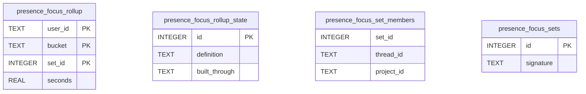

# Presence Rollup Schema

Tables in the primary store created by `backend/infra/presence_rollup_schema.py`.

## Tables 1–4

### `presence_focus_rollup`

| Column | Type | Primary key | NOT NULL | Default | References ||---|---|---|---|---|---|
| `user_id` | TEXT | Yes | Yes | — | — |
| `bucket` | TEXT | Yes | Yes | — | — |
| `set_id` | INTEGER | Yes | Yes | — | — |
| `seconds` | REAL | No | Yes | — | — |

Indexes: `sqlite_autoindex_presence_focus_rollup_1` (user_id, bucket, set_id, unique).

### `presence_focus_rollup_state`

| Column | Type | Primary key | NOT NULL | Default | References ||---|---|---|---|---|---|
| `id` | INTEGER | Yes | No | — | — |
| `definition` | TEXT | No | Yes | — | — |
| `built_through` | TEXT | No | Yes | — | — |

Indexes: None.

### `presence_focus_set_members`

| Column | Type | Primary key | NOT NULL | Default | References ||---|---|---|---|---|---|
| `set_id` | INTEGER | No | Yes | — | — |
| `thread_id` | TEXT | No | No | — | — |
| `project_id` | TEXT | No | No | — | — |

Indexes: `idx_presence_focus_set_members_set` (set_id).

### `presence_focus_sets`

| Column | Type | Primary key | NOT NULL | Default | References ||---|---|---|---|---|---|
| `id` | INTEGER | Yes | No | — | — |
| `signature` | TEXT | No | Yes | — | — |

Indexes: `sqlite_autoindex_presence_focus_sets_1` (signature, unique).
