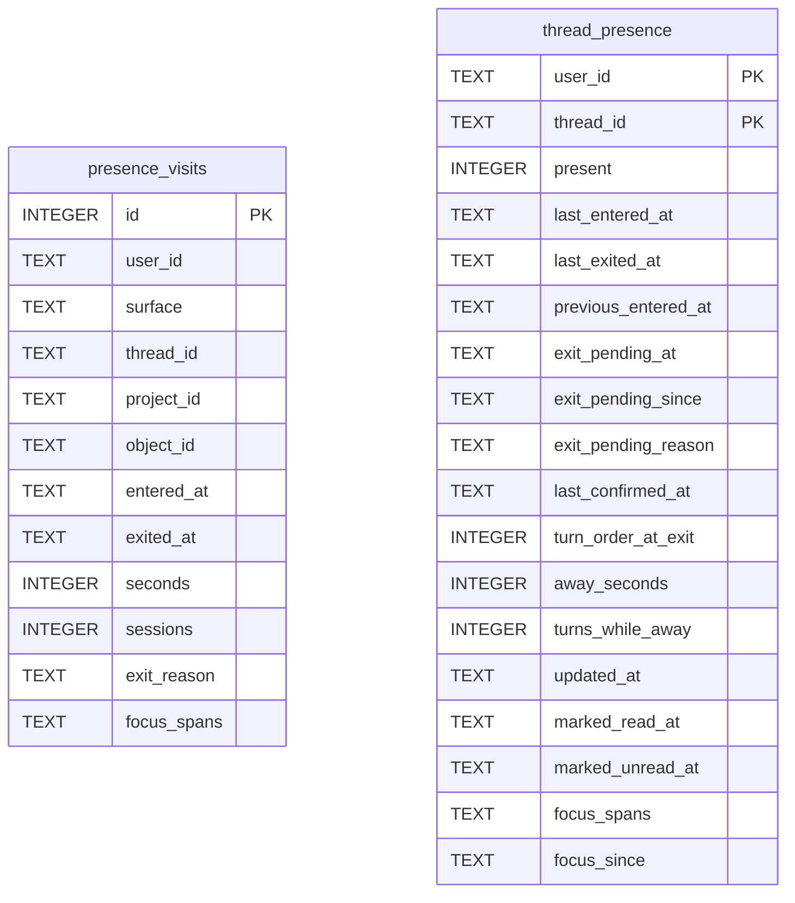

# Presence Schema

Tables in the primary store created by `backend/infra/presence_schema.py`.

## Tables 1–2

### `presence_visits`

| Column | Type | Primary key | NOT NULL | Default | References ||---|---|---|---|---|---|
| `id` | INTEGER | Yes | No | — | — |
| `user_id` | TEXT | No | Yes | — | — |
| `surface` | TEXT | No | Yes | — | — |
| `thread_id` | TEXT | No | No | — | — |
| `project_id` | TEXT | No | No | — | — |
| `object_id` | TEXT | No | No | — | — |
| `entered_at` | TEXT | No | Yes | — | — |
| `exited_at` | TEXT | No | Yes | — | — |
| `seconds` | INTEGER | No | Yes | — | — |
| `sessions` | INTEGER | No | Yes | — | — |
| `exit_reason` | TEXT | No | Yes | — | — |
| `focus_spans` | TEXT | No | No | — | — |

Indexes: `idx_presence_visits_thread` (thread_id, entered_at), `idx_presence_visits_user_time` (user_id, entered_at).

### `thread_presence`

| Column | Type | Primary key | NOT NULL | Default | References ||---|---|---|---|---|---|
| `user_id` | TEXT | Yes | Yes | — | — |
| `thread_id` | TEXT | Yes | Yes | — | threads.id |
| `present` | INTEGER | No | Yes | 0 | — |
| `last_entered_at` | TEXT | No | Yes | — | — |
| `last_exited_at` | TEXT | No | No | — | — |
| `previous_entered_at` | TEXT | No | No | — | — |
| `exit_pending_at` | TEXT | No | No | — | — |
| `exit_pending_since` | TEXT | No | No | — | — |
| `exit_pending_reason` | TEXT | No | No | — | — |
| `last_confirmed_at` | TEXT | No | Yes | — | — |
| `turn_order_at_exit` | INTEGER | No | No | — | — |
| `away_seconds` | INTEGER | No | No | — | — |
| `turns_while_away` | INTEGER | No | No | — | — |
| `updated_at` | TEXT | No | Yes | — | — |
| `marked_read_at` | TEXT | No | No | — | — |
| `marked_unread_at` | TEXT | No | No | — | — |
| `focus_spans` | TEXT | No | No | — | — |
| `focus_since` | TEXT | No | No | — | — |

Indexes: `idx_thread_presence_thread` (thread_id), `sqlite_autoindex_thread_presence_1` (user_id, thread_id, unique).
