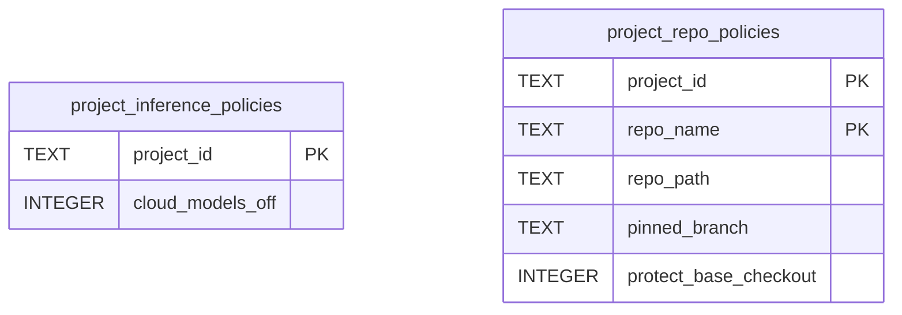

# Project Policy Schema

Tables in the primary store created by `backend/infra/project_policy_schema.py`.

## Tables 1–2

### `project_inference_policies`

| Column | Type | Primary key | NOT NULL | Default | References ||---|---|---|---|---|---|
| `project_id` | TEXT | Yes | No | — | projects.id |
| `cloud_models_off` | INTEGER | No | Yes | 0 | — |

Indexes: `sqlite_autoindex_project_inference_policies_1` (project_id, unique).

### `project_repo_policies`

| Column | Type | Primary key | NOT NULL | Default | References ||---|---|---|---|---|---|
| `project_id` | TEXT | Yes | Yes | — | projects.id |
| `repo_name` | TEXT | Yes | Yes | — | — |
| `repo_path` | TEXT | No | Yes | — | — |
| `pinned_branch` | TEXT | No | No | — | — |
| `protect_base_checkout` | INTEGER | No | Yes | 1 | — |

Indexes: `sqlite_autoindex_project_repo_policies_1` (project_id, repo_name, unique).
