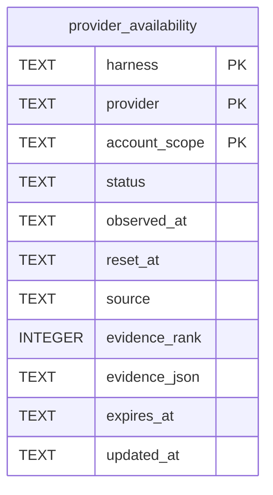

# Provider Availability Schema

Tables in the primary store created by `backend/infra/provider_availability_schema.py`.

## Tables 1–1

### `provider_availability`

| Column | Type | Primary key | NOT NULL | Default | References ||---|---|---|---|---|---|
| `harness` | TEXT | Yes | Yes | — | — |
| `provider` | TEXT | Yes | Yes | — | — |
| `account_scope` | TEXT | Yes | Yes | — | — |
| `status` | TEXT | No | Yes | — | — |
| `observed_at` | TEXT | No | Yes | — | — |
| `reset_at` | TEXT | No | No | — | — |
| `source` | TEXT | No | Yes | — | — |
| `evidence_rank` | INTEGER | No | Yes | — | — |
| `evidence_json` | TEXT | No | Yes | — | — |
| `expires_at` | TEXT | No | Yes | — | — |
| `updated_at` | TEXT | No | Yes | — | — |

Indexes: `sqlite_autoindex_provider_availability_1` (harness, provider, account_scope, unique).
