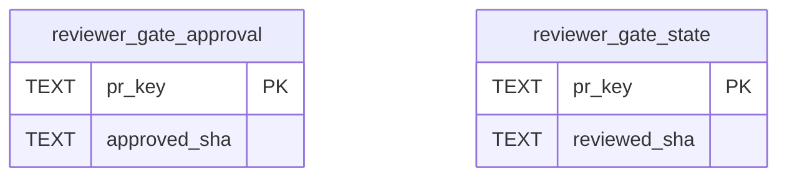

# Reviewer Gate Schema

Tables in the primary store created by `backend/infra/reviewer_gate_schema.py`.

## Tables 1–2

### `reviewer_gate_approval`

| Column | Type | Primary key | NOT NULL | Default | References ||---|---|---|---|---|---|
| `pr_key` | TEXT | Yes | No | — | — |
| `approved_sha` | TEXT | No | Yes | — | — |

Indexes: `sqlite_autoindex_reviewer_gate_approval_1` (pr_key, unique).

### `reviewer_gate_state`

| Column | Type | Primary key | NOT NULL | Default | References ||---|---|---|---|---|---|
| `pr_key` | TEXT | Yes | No | — | — |
| `reviewed_sha` | TEXT | No | Yes | — | — |

Indexes: `sqlite_autoindex_reviewer_gate_state_1` (pr_key, unique).
