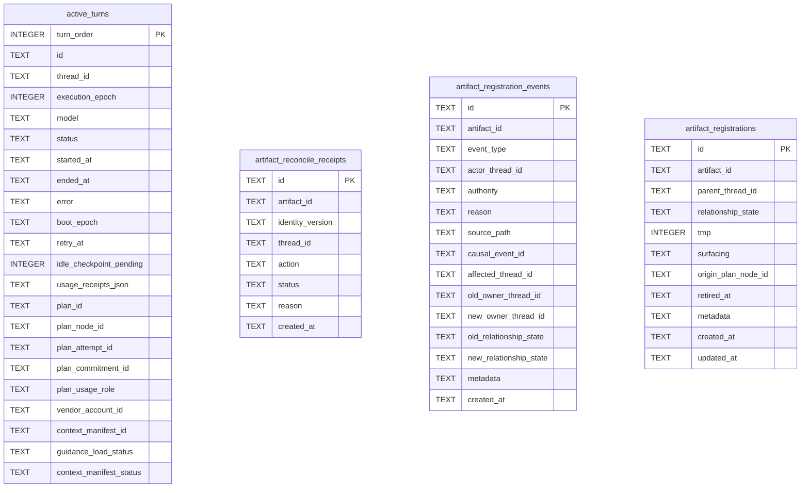
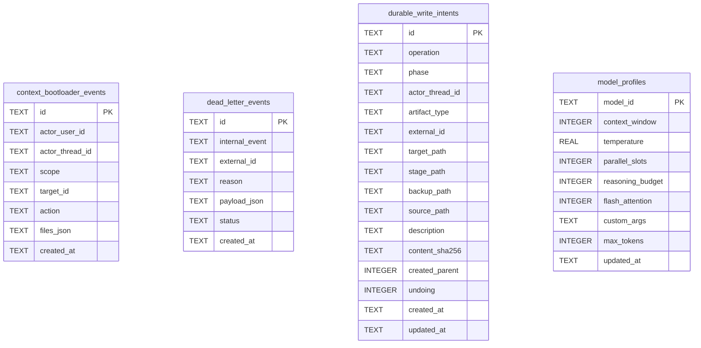
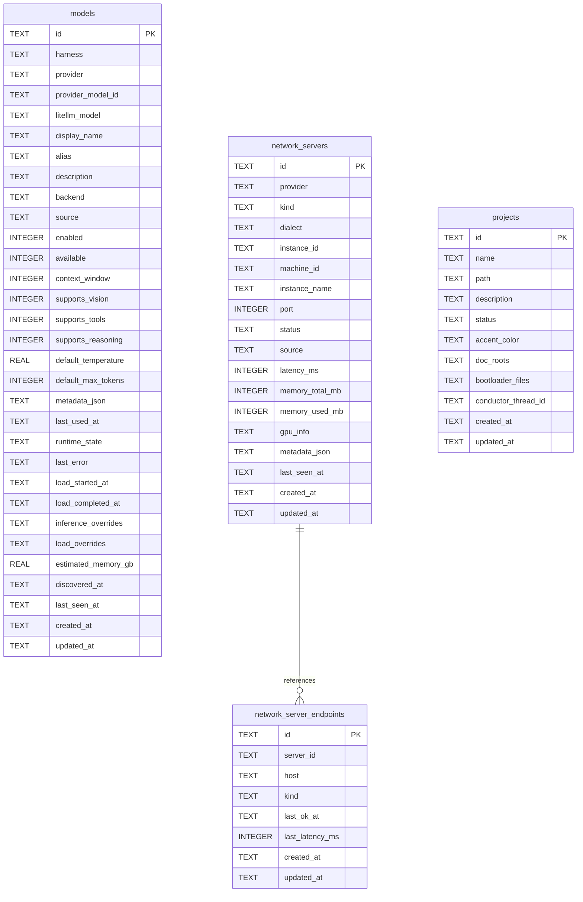
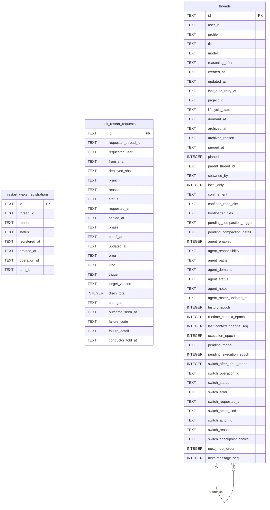

# Schema

Tables in the primary store created by `backend/infra/schema.py`.

## Tables 1–4

### `active_turns`

| Column | Type | Primary key | NOT NULL | Default | References ||---|---|---|---|---|---|
| `turn_order` | INTEGER | Yes | No | — | — |
| `id` | TEXT | No | Yes | — | — |
| `thread_id` | TEXT | No | Yes | — | threads.id |
| `execution_epoch` | INTEGER | No | Yes | — | — |
| `model` | TEXT | No | Yes | — | — |
| `status` | TEXT | No | Yes | 'running' | — |
| `started_at` | TEXT | No | Yes | — | — |
| `ended_at` | TEXT | No | No | — | — |
| `error` | TEXT | No | No | — | — |
| `boot_epoch` | TEXT | No | Yes | — | — |
| `retry_at` | TEXT | No | No | — | — |
| `idle_checkpoint_pending` | INTEGER | No | Yes | 0 | — |
| `usage_receipts_json` | TEXT | No | Yes | '{}' | — |
| `plan_id` | TEXT | No | No | — | — |
| `plan_node_id` | TEXT | No | No | — | — |
| `plan_attempt_id` | TEXT | No | No | — | — |
| `plan_commitment_id` | TEXT | No | No | — | — |
| `plan_usage_role` | TEXT | No | No | — | — |
| `vendor_account_id` | TEXT | No | No | — | vendor_accounts.id |
| `context_manifest_id` | TEXT | No | No | — | — |
| `guidance_load_status` | TEXT | No | No | — | — |
| `context_manifest_status` | TEXT | No | No | 'unbound' | — |

Indexes: `idx_active_turns_idle_checkpoint_due` (ended_at, turn_order), `idx_active_turns_one_active` (thread_id, unique), `idx_active_turns_pending_usage` (turn_order), `idx_active_turns_plan_node` (plan_node_id), `idx_active_turns_session` (thread_id), `idx_active_turns_status` (status), `idx_active_turns_thread_status` (thread_id, status), `sqlite_autoindex_active_turns_1` (id, unique).

### `artifact_reconcile_receipts`

| Column | Type | Primary key | NOT NULL | Default | References ||---|---|---|---|---|---|
| `id` | TEXT | Yes | No | — | — |
| `artifact_id` | TEXT | No | Yes | — | artifact_identities.id |
| `identity_version` | TEXT | No | Yes | — | — |
| `thread_id` | TEXT | No | Yes | — | — |
| `action` | TEXT | No | Yes | — | — |
| `status` | TEXT | No | Yes | — | — |
| `reason` | TEXT | No | No | — | — |
| `created_at` | TEXT | No | Yes | — | — |

Indexes: `idx_artifact_reconcile_receipts_session` (thread_id, created_at), `sqlite_autoindex_artifact_reconcile_receipts_1` (id, unique), `sqlite_autoindex_artifact_reconcile_receipts_2` (artifact_id, identity_version, thread_id, unique).

### `artifact_registration_events`

| Column | Type | Primary key | NOT NULL | Default | References ||---|---|---|---|---|---|
| `id` | TEXT | Yes | No | — | — |
| `artifact_id` | TEXT | No | Yes | — | artifact_identities.id |
| `event_type` | TEXT | No | Yes | — | — |
| `actor_thread_id` | TEXT | No | No | — | — |
| `authority` | TEXT | No | No | — | — |
| `reason` | TEXT | No | No | — | — |
| `source_path` | TEXT | No | No | — | — |
| `causal_event_id` | TEXT | No | No | — | — |
| `affected_thread_id` | TEXT | No | No | — | — |
| `old_owner_thread_id` | TEXT | No | No | — | — |
| `new_owner_thread_id` | TEXT | No | No | — | — |
| `old_relationship_state` | TEXT | No | No | — | — |
| `new_relationship_state` | TEXT | No | No | — | — |
| `metadata` | TEXT | No | No | — | — |
| `created_at` | TEXT | No | Yes | — | — |

Indexes: `idx_artifact_registration_events_artifact` (artifact_id, created_at), `idx_artifact_registration_events_thread` (affected_thread_id, created_at), `sqlite_autoindex_artifact_registration_events_1` (id, unique).

### `artifact_registrations`

| Column | Type | Primary key | NOT NULL | Default | References ||---|---|---|---|---|---|
| `id` | TEXT | Yes | No | — | — |
| `artifact_id` | TEXT | No | Yes | — | artifact_identities.id |
| `parent_thread_id` | TEXT | No | Yes | — | — |
| `relationship_state` | TEXT | No | Yes | 'owner-active' | — |
| `tmp` | INTEGER | No | Yes | 0 | — |
| `surfacing` | TEXT | No | Yes | 'visible' | — |
| `origin_plan_node_id` | TEXT | No | No | — | — |
| `retired_at` | TEXT | No | No | — | — |
| `metadata` | TEXT | No | No | — | — |
| `created_at` | TEXT | No | Yes | — | — |
| `updated_at` | TEXT | No | Yes | — | — |

Indexes: `idx_artifact_registrations_artifact` (artifact_id, relationship_state), `idx_artifact_registrations_thread` (parent_thread_id, updated_at), `sqlite_autoindex_artifact_registrations_1` (id, unique), `sqlite_autoindex_artifact_registrations_2` (artifact_id, parent_thread_id, unique).

## Tables 5–8

### `context_bootloader_events`

| Column | Type | Primary key | NOT NULL | Default | References ||---|---|---|---|---|---|
| `id` | TEXT | Yes | No | — | — |
| `actor_user_id` | TEXT | No | No | — | — |
| `actor_thread_id` | TEXT | No | No | — | threads.id |
| `scope` | TEXT | No | Yes | — | — |
| `target_id` | TEXT | No | Yes | — | — |
| `action` | TEXT | No | Yes | — | — |
| `files_json` | TEXT | No | Yes | — | — |
| `created_at` | TEXT | No | Yes | — | — |

Indexes: `idx_context_bootloader_events_target` (scope, target_id, created_at), `sqlite_autoindex_context_bootloader_events_1` (id, unique).

### `dead_letter_events`

| Column | Type | Primary key | NOT NULL | Default | References ||---|---|---|---|---|---|
| `id` | TEXT | Yes | No | — | — |
| `internal_event` | TEXT | No | Yes | — | — |
| `external_id` | TEXT | No | No | — | — |
| `reason` | TEXT | No | Yes | — | — |
| `payload_json` | TEXT | No | No | — | — |
| `status` | TEXT | No | Yes | 'parked' | — |
| `created_at` | TEXT | No | Yes | — | — |

Indexes: `idx_dead_letter_status` (status, created_at), `sqlite_autoindex_dead_letter_events_1` (id, unique).

### `durable_write_intents`

| Column | Type | Primary key | NOT NULL | Default | References ||---|---|---|---|---|---|
| `id` | TEXT | Yes | No | — | — |
| `operation` | TEXT | No | Yes | — | — |
| `phase` | TEXT | No | Yes | — | — |
| `actor_thread_id` | TEXT | No | Yes | — | — |
| `artifact_type` | TEXT | No | Yes | — | — |
| `external_id` | TEXT | No | Yes | — | — |
| `target_path` | TEXT | No | Yes | — | — |
| `stage_path` | TEXT | No | Yes | — | — |
| `backup_path` | TEXT | No | No | — | — |
| `source_path` | TEXT | No | No | — | — |
| `description` | TEXT | No | No | — | — |
| `content_sha256` | TEXT | No | Yes | — | — |
| `created_parent` | INTEGER | No | Yes | 0 | — |
| `undoing` | INTEGER | No | Yes | 0 | — |
| `created_at` | TEXT | No | Yes | — | — |
| `updated_at` | TEXT | No | Yes | — | — |

Indexes: `sqlite_autoindex_durable_write_intents_1` (id, unique), `sqlite_autoindex_durable_write_intents_2` (target_path, unique).

### `model_profiles`

| Column | Type | Primary key | NOT NULL | Default | References ||---|---|---|---|---|---|
| `model_id` | TEXT | Yes | No | — | — |
| `context_window` | INTEGER | No | No | — | — |
| `temperature` | REAL | No | No | — | — |
| `parallel_slots` | INTEGER | No | No | 1 | — |
| `reasoning_budget` | INTEGER | No | No | -1 | — |
| `flash_attention` | INTEGER | No | No | 1 | — |
| `custom_args` | TEXT | No | No | — | — |
| `max_tokens` | INTEGER | No | No | — | — |
| `updated_at` | TEXT | No | No | — | — |

Indexes: `sqlite_autoindex_model_profiles_1` (model_id, unique).

## Tables 9–12

### `models`

| Column | Type | Primary key | NOT NULL | Default | References ||---|---|---|---|---|---|
| `id` | TEXT | Yes | No | — | — |
| `harness` | TEXT | No | Yes | 'native' | — |
| `provider` | TEXT | No | Yes | — | — |
| `provider_model_id` | TEXT | No | Yes | — | — |
| `litellm_model` | TEXT | No | Yes | — | — |
| `display_name` | TEXT | No | Yes | — | — |
| `alias` | TEXT | No | No | — | — |
| `description` | TEXT | No | No | — | — |
| `backend` | TEXT | No | Yes | 'api' | — |
| `source` | TEXT | No | Yes | 'seed' | — |
| `enabled` | INTEGER | No | Yes | 1 | — |
| `available` | INTEGER | No | Yes | 1 | — |
| `context_window` | INTEGER | No | No | — | — |
| `supports_vision` | INTEGER | No | No | 0 | — |
| `supports_tools` | INTEGER | No | No | 1 | — |
| `supports_reasoning` | INTEGER | No | No | 0 | — |
| `default_temperature` | REAL | No | No | 0.3 | — |
| `default_max_tokens` | INTEGER | No | No | 8192 | — |
| `metadata_json` | TEXT | No | No | — | — |
| `last_used_at` | TEXT | No | No | — | — |
| `runtime_state` | TEXT | No | No | 'idle' | — |
| `last_error` | TEXT | No | No | — | — |
| `load_started_at` | TEXT | No | No | — | — |
| `load_completed_at` | TEXT | No | No | — | — |
| `inference_overrides` | TEXT | No | No | — | — |
| `load_overrides` | TEXT | No | No | — | — |
| `estimated_memory_gb` | REAL | No | No | — | — |
| `discovered_at` | TEXT | No | No | — | — |
| `last_seen_at` | TEXT | No | No | — | — |
| `created_at` | TEXT | No | Yes | — | — |
| `updated_at` | TEXT | No | Yes | — | — |

Indexes: `sqlite_autoindex_models_1` (id, unique), `sqlite_autoindex_models_2` (provider, provider_model_id, unique).

### `network_server_endpoints`

| Column | Type | Primary key | NOT NULL | Default | References ||---|---|---|---|---|---|
| `id` | TEXT | Yes | No | — | — |
| `server_id` | TEXT | No | Yes | — | network_servers.id |
| `host` | TEXT | No | Yes | — | — |
| `kind` | TEXT | No | Yes | — | — |
| `last_ok_at` | TEXT | No | No | — | — |
| `last_latency_ms` | INTEGER | No | No | — | — |
| `created_at` | TEXT | No | Yes | — | — |
| `updated_at` | TEXT | No | Yes | — | — |

Indexes: `idx_network_endpoints_server` (server_id), `sqlite_autoindex_network_server_endpoints_1` (id, unique), `sqlite_autoindex_network_server_endpoints_2` (server_id, host, unique).

### `network_servers`

| Column | Type | Primary key | NOT NULL | Default | References ||---|---|---|---|---|---|
| `id` | TEXT | Yes | No | — | — |
| `provider` | TEXT | No | Yes | 'omlx' | — |
| `kind` | TEXT | No | Yes | 'managed' | — |
| `dialect` | TEXT | No | No | — | — |
| `instance_id` | TEXT | No | Yes | — | — |
| `machine_id` | TEXT | No | No | — | — |
| `instance_name` | TEXT | No | Yes | — | — |
| `port` | INTEGER | No | Yes | — | — |
| `status` | TEXT | No | Yes | 'offline' | — |
| `source` | TEXT | No | No | 'manual' | — |
| `latency_ms` | INTEGER | No | No | — | — |
| `memory_total_mb` | INTEGER | No | No | — | — |
| `memory_used_mb` | INTEGER | No | No | — | — |
| `gpu_info` | TEXT | No | No | — | — |
| `metadata_json` | TEXT | No | No | — | — |
| `last_seen_at` | TEXT | No | Yes | — | — |
| `created_at` | TEXT | No | Yes | — | — |
| `updated_at` | TEXT | No | Yes | — | — |

Indexes: `idx_network_servers_provider` (provider, status), `sqlite_autoindex_network_servers_1` (id, unique), `sqlite_autoindex_network_servers_2` (provider, instance_id, unique).

### `projects`

| Column | Type | Primary key | NOT NULL | Default | References ||---|---|---|---|---|---|
| `id` | TEXT | Yes | No | — | — |
| `name` | TEXT | No | Yes | — | — |
| `path` | TEXT | No | No | — | — |
| `description` | TEXT | No | No | — | — |
| `status` | TEXT | No | No | 'active' | — |
| `accent_color` | TEXT | No | No | — | — |
| `doc_roots` | TEXT | No | No | — | — |
| `bootloader_files` | TEXT | No | No | — | — |
| `conductor_thread_id` | TEXT | No | No | — | — |
| `created_at` | TEXT | No | Yes | — | — |
| `updated_at` | TEXT | No | Yes | — | — |

Indexes: `idx_projects_status` (status), `sqlite_autoindex_projects_1` (id, unique), `sqlite_autoindex_projects_2` (name, unique).

## Tables 13–15

### `restart_wake_registrations`

| Column | Type | Primary key | NOT NULL | Default | References ||---|---|---|---|---|---|
| `id` | TEXT | Yes | No | — | — |
| `thread_id` | TEXT | No | Yes | — | — |
| `reason` | TEXT | No | No | — | — |
| `status` | TEXT | No | Yes | 'pending' | — |
| `registered_at` | TEXT | No | Yes | — | — |
| `drained_at` | TEXT | No | No | — | — |
| `operation_id` | TEXT | No | No | — | — |
| `turn_id` | TEXT | No | No | — | — |

Indexes: `idx_restart_registrations_status` (status), `idx_restart_registrations_turn` (operation_id, turn_id, status), `sqlite_autoindex_restart_wake_registrations_1` (id, unique).

### `self_restart_requests`

| Column | Type | Primary key | NOT NULL | Default | References ||---|---|---|---|---|---|
| `id` | TEXT | Yes | No | — | — |
| `requester_thread_id` | TEXT | No | No | — | — |
| `requester_user` | TEXT | No | No | — | — |
| `from_sha` | TEXT | No | No | — | — |
| `deployed_sha` | TEXT | No | No | — | — |
| `branch` | TEXT | No | No | — | — |
| `reason` | TEXT | No | No | — | — |
| `status` | TEXT | No | Yes | 'in_flight' | — |
| `requested_at` | TEXT | No | Yes | — | — |
| `settled_at` | TEXT | No | No | — | — |
| `phase` | TEXT | No | No | — | — |
| `cutoff_at` | TEXT | No | No | — | — |
| `updated_at` | TEXT | No | No | — | — |
| `error` | TEXT | No | No | — | — |
| `kind` | TEXT | No | No | — | — |
| `trigger` | TEXT | No | No | — | — |
| `target_version` | TEXT | No | No | — | — |
| `drain_total` | INTEGER | No | No | — | — |
| `changes` | TEXT | No | No | — | — |
| `outcome_seen_at` | TEXT | No | No | — | — |
| `failure_code` | TEXT | No | No | — | — |
| `failure_detail` | TEXT | No | No | — | — |
| `conductor_told_at` | TEXT | No | No | — | — |

Indexes: `idx_self_restart_requests_status` (status), `idx_self_restart_requests_update_attempts` (kind, requested_at), `sqlite_autoindex_self_restart_requests_1` (id, unique).

### `threads`

| Column | Type | Primary key | NOT NULL | Default | References ||---|---|---|---|---|---|
| `id` | TEXT | Yes | No | — | — |
| `user_id` | TEXT | No | Yes | — | — |
| `profile` | TEXT | No | No | 'personal' | — |
| `title` | TEXT | No | No | 'New Chat' | — |
| `model` | TEXT | No | No | — | — |
| `reasoning_effort` | TEXT | No | No | — | — |
| `created_at` | TEXT | No | Yes | — | — |
| `updated_at` | TEXT | No | Yes | — | — |
| `last_auto_retry_at` | TEXT | No | No | — | — |
| `project_id` | TEXT | No | No | — | projects.id |
| `lifecycle_state` | TEXT | No | No | 'active' | — |
| `dormant_at` | TEXT | No | No | — | — |
| `archived_at` | TEXT | No | No | — | — |
| `archived_reason` | TEXT | No | No | — | — |
| `purged_at` | TEXT | No | No | — | — |
| `pinned` | INTEGER | No | No | 0 | — |
| `parent_thread_id` | TEXT | No | No | — | threads.id |
| `spawned_by` | TEXT | No | No | — | threads.id |
| `local_only` | INTEGER | No | Yes | 0 | — |
| `confinement` | TEXT | No | No | — | — |
| `confined_read_dirs` | TEXT | No | No | — | — |
| `bootloader_files` | TEXT | No | No | — | — |
| `pending_compaction_trigger` | TEXT | No | No | — | — |
| `pending_compaction_detail` | TEXT | No | No | — | — |
| `agent_enabled` | INTEGER | No | No | 0 | — |
| `agent_responsibility` | TEXT | No | No | — | — |
| `agent_paths` | TEXT | No | No | — | — |
| `agent_domains` | TEXT | No | No | — | — |
| `agent_status` | TEXT | No | No | 'active' | — |
| `agent_notes` | TEXT | No | No | — | — |
| `agent_roster_updated_at` | TEXT | No | Yes | '1970-01-01T00:00:00+00:00' | — |
| `history_epoch` | INTEGER | No | Yes | 0 | — |
| `runtime_context_epoch` | INTEGER | No | Yes | 0 | — |
| `last_context_change_seq` | INTEGER | No | Yes | 0 | — |
| `execution_epoch` | INTEGER | No | Yes | 0 | — |
| `pending_model` | TEXT | No | No | — | — |
| `pending_execution_epoch` | INTEGER | No | No | — | — |
| `switch_after_input_order` | INTEGER | No | No | — | — |
| `switch_operation_id` | TEXT | No | No | — | — |
| `switch_status` | TEXT | No | No | — | — |
| `switch_error` | TEXT | No | No | — | — |
| `switch_requested_at` | TEXT | No | No | — | — |
| `switch_actor_kind` | TEXT | No | No | — | — |
| `switch_actor_id` | TEXT | No | No | — | — |
| `switch_reason` | TEXT | No | No | — | — |
| `switch_checkpoint_choice` | TEXT | No | No | — | — |
| `next_input_order` | INTEGER | No | Yes | 1 | — |
| `next_message_seq` | INTEGER | No | Yes | 1 | — |

Indexes: `idx_measurement_thread_children` (parent_thread_id, user_id), `idx_threads_user` (user_id, updated_at), `sqlite_autoindex_threads_1` (id, unique).
