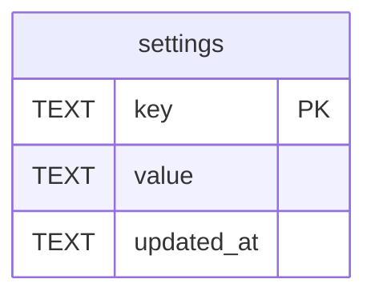

# Settings Schema

Tables in the primary store created by `backend/infra/settings_schema.py`.

## Tables 1–1

### `settings`

| Column | Type | Primary key | NOT NULL | Default | References ||---|---|---|---|---|---|
| `key` | TEXT | Yes | No | — | — |
| `value` | TEXT | No | Yes | — | — |
| `updated_at` | TEXT | No | Yes | — | — |

Indexes: `sqlite_autoindex_settings_1` (key, unique).
