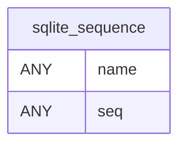

# SQLite internal

Tables in the primary store created by `SQLite internal`.

## Tables 1–1

### `sqlite_sequence`

| Column | Type | Primary key | NOT NULL | Default | References ||---|---|---|---|---|---|
| `name` |  | No | No | — | — |
| `seq` |  | No | No | — | — |

Indexes: None.
