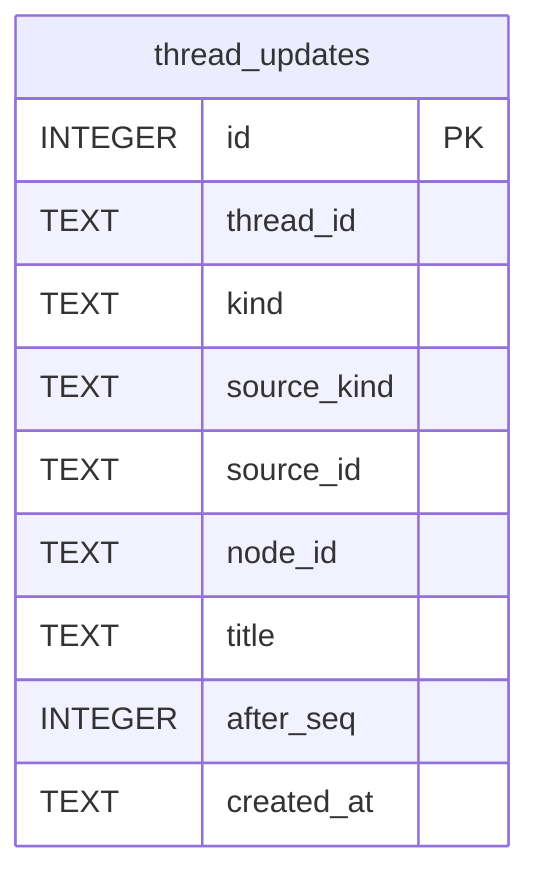

# Thread Updates Schema

Tables in the primary store created by `backend/infra/thread_updates_schema.py`.

## Tables 1–1

### `thread_updates`

| Column | Type | Primary key | NOT NULL | Default | References ||---|---|---|---|---|---|
| `id` | INTEGER | Yes | No | — | — |
| `thread_id` | TEXT | No | Yes | — | threads.id |
| `kind` | TEXT | No | Yes | — | — |
| `source_kind` | TEXT | No | Yes | — | — |
| `source_id` | TEXT | No | Yes | — | — |
| `node_id` | TEXT | No | No | — | — |
| `title` | TEXT | No | No | — | — |
| `after_seq` | INTEGER | No | Yes | — | — |
| `created_at` | TEXT | No | Yes | — | — |

Indexes: `idx_thread_updates_node` (node_id, id), `idx_thread_updates_thread_seq` (thread_id, after_seq), `idx_thread_updates_thread_time` (thread_id, created_at), `sqlite_autoindex_thread_updates_1` (source_kind, source_id, unique).
