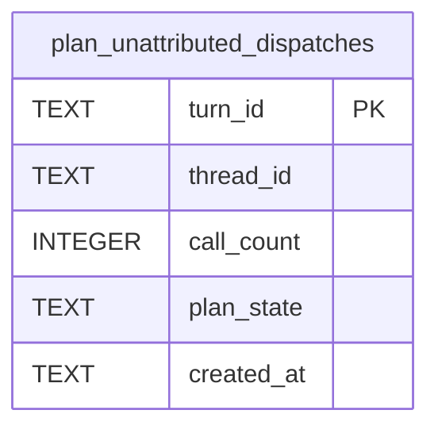

# Unattributed Dispatch Schema

Tables in the primary store created by `backend/infra/unattributed_dispatch_schema.py`.

## Tables 1–1

### `plan_unattributed_dispatches`

| Column | Type | Primary key | NOT NULL | Default | References ||---|---|---|---|---|---|
| `turn_id` | TEXT | Yes | No | — | — |
| `thread_id` | TEXT | No | Yes | — | — |
| `call_count` | INTEGER | No | Yes | — | — |
| `plan_state` | TEXT | No | Yes | — | — |
| `created_at` | TEXT | No | Yes | — | — |

Indexes: `idx_plan_unattributed_dispatches_thread` (thread_id, created_at), `sqlite_autoindex_plan_unattributed_dispatches_1` (turn_id, unique).
