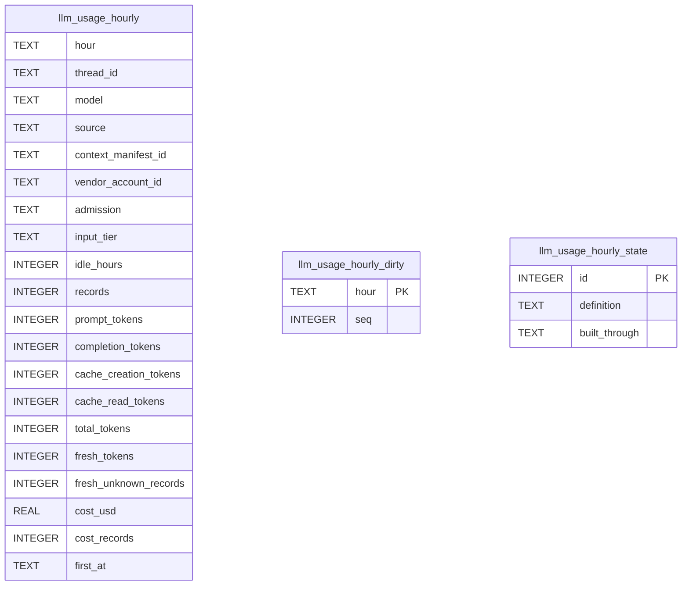

# Usage Rollup Schema

Tables in the primary store created by `backend/infra/usage_rollup_schema.py`.

## Tables 1–3

### `llm_usage_hourly`

| Column | Type | Primary key | NOT NULL | Default | References ||---|---|---|---|---|---|
| `hour` | TEXT | No | Yes | — | — |
| `thread_id` | TEXT | No | No | — | — |
| `model` | TEXT | No | No | — | — |
| `source` | TEXT | No | No | — | — |
| `context_manifest_id` | TEXT | No | No | — | — |
| `vendor_account_id` | TEXT | No | No | — | — |
| `admission` | TEXT | No | Yes | — | — |
| `input_tier` | TEXT | No | Yes | — | — |
| `idle_hours` | INTEGER | No | Yes | — | — |
| `records` | INTEGER | No | Yes | — | — |
| `prompt_tokens` | INTEGER | No | No | — | — |
| `completion_tokens` | INTEGER | No | No | — | — |
| `cache_creation_tokens` | INTEGER | No | No | — | — |
| `cache_read_tokens` | INTEGER | No | No | — | — |
| `total_tokens` | INTEGER | No | No | — | — |
| `fresh_tokens` | INTEGER | No | No | — | — |
| `fresh_unknown_records` | INTEGER | No | No | — | — |
| `cost_usd` | REAL | No | No | — | — |
| `cost_records` | INTEGER | No | Yes | — | — |
| `first_at` | TEXT | No | Yes | — | — |

Indexes: `idx_llm_usage_hourly_hour` (hour, thread_id).

### `llm_usage_hourly_dirty`

| Column | Type | Primary key | NOT NULL | Default | References ||---|---|---|---|---|---|
| `hour` | TEXT | Yes | No | — | — |
| `seq` | INTEGER | No | Yes | 1 | — |

Indexes: `sqlite_autoindex_llm_usage_hourly_dirty_1` (hour, unique).

### `llm_usage_hourly_state`

| Column | Type | Primary key | NOT NULL | Default | References ||---|---|---|---|---|---|
| `id` | INTEGER | Yes | No | — | — |
| `definition` | TEXT | No | Yes | — | — |
| `built_through` | TEXT | No | Yes | — | — |

Indexes: None.
