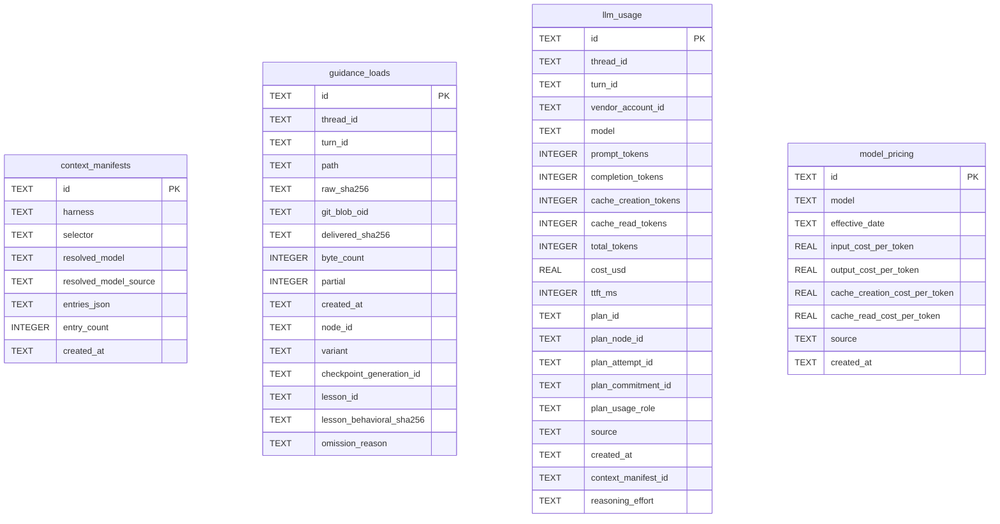

# Usage Schema

Tables in the primary store created by `backend/infra/usage_schema.py`.

## Tables 1–4

### `context_manifests`

| Column | Type | Primary key | NOT NULL | Default | References ||---|---|---|---|---|---|
| `id` | TEXT | Yes | No | — | — |
| `harness` | TEXT | No | Yes | — | — |
| `selector` | TEXT | No | No | — | — |
| `resolved_model` | TEXT | No | No | — | — |
| `resolved_model_source` | TEXT | No | No | — | — |
| `entries_json` | TEXT | No | Yes | — | — |
| `entry_count` | INTEGER | No | Yes | — | — |
| `created_at` | TEXT | No | Yes | — | — |

Indexes: `sqlite_autoindex_context_manifests_1` (id, unique).

### `guidance_loads`

| Column | Type | Primary key | NOT NULL | Default | References ||---|---|---|---|---|---|
| `id` | TEXT | Yes | No | — | — |
| `thread_id` | TEXT | No | No | — | — |
| `turn_id` | TEXT | No | No | — | — |
| `path` | TEXT | No | Yes | — | — |
| `raw_sha256` | TEXT | No | Yes | — | — |
| `git_blob_oid` | TEXT | No | Yes | — | — |
| `delivered_sha256` | TEXT | No | Yes | — | — |
| `byte_count` | INTEGER | No | Yes | — | — |
| `partial` | INTEGER | No | Yes | — | — |
| `created_at` | TEXT | No | Yes | — | — |
| `node_id` | TEXT | No | No | — | — |
| `variant` | TEXT | No | No | — | — |
| `checkpoint_generation_id` | TEXT | No | No | — | — |
| `lesson_id` | TEXT | No | No | — | — |
| `lesson_behavioral_sha256` | TEXT | No | No | — | — |
| `omission_reason` | TEXT | No | No | — | — |

Indexes: `idx_guidance_loads_lesson_node` (lesson_id, lesson_behavioral_sha256, node_id), `idx_guidance_loads_trial_thread_time` (thread_id, created_at, lesson_id, lesson_behavioral_sha256, id), `idx_guidance_loads_turn` (turn_id), `sqlite_autoindex_guidance_loads_1` (id, unique).

### `llm_usage`

| Column | Type | Primary key | NOT NULL | Default | References ||---|---|---|---|---|---|
| `id` | TEXT | Yes | No | — | — |
| `thread_id` | TEXT | No | Yes | — | — |
| `turn_id` | TEXT | No | No | — | — |
| `vendor_account_id` | TEXT | No | No | — | vendor_accounts.id |
| `model` | TEXT | No | Yes | — | — |
| `prompt_tokens` | INTEGER | No | No | 0 | — |
| `completion_tokens` | INTEGER | No | No | 0 | — |
| `cache_creation_tokens` | INTEGER | No | No | 0 | — |
| `cache_read_tokens` | INTEGER | No | No | 0 | — |
| `total_tokens` | INTEGER | No | No | 0 | — |
| `cost_usd` | REAL | No | No | 0.0 | — |
| `ttft_ms` | INTEGER | No | No | — | — |
| `plan_id` | TEXT | No | No | — | — |
| `plan_node_id` | TEXT | No | No | — | — |
| `plan_attempt_id` | TEXT | No | No | — | — |
| `plan_commitment_id` | TEXT | No | No | — | — |
| `plan_usage_role` | TEXT | No | No | — | — |
| `source` | TEXT | No | Yes | 'conversation' | — |
| `created_at` | TEXT | No | Yes | — | — |
| `context_manifest_id` | TEXT | No | No | — | — |
| `reasoning_effort` | TEXT | No | No | — | — |

Indexes: `idx_llm_usage_commitment` (plan_commitment_id, created_at), `idx_llm_usage_context_manifest` (context_manifest_id), `idx_llm_usage_created_at` (created_at), `idx_llm_usage_model` (model, created_at), `idx_llm_usage_plan_node` (plan_node_id), `idx_llm_usage_priceable_measurement_start` (created_at), `idx_llm_usage_session` (thread_id, created_at), `idx_llm_usage_source` (source, created_at), `sqlite_autoindex_llm_usage_1` (id, unique).

### `model_pricing`

| Column | Type | Primary key | NOT NULL | Default | References ||---|---|---|---|---|---|
| `id` | TEXT | Yes | No | — | — |
| `model` | TEXT | No | Yes | — | — |
| `effective_date` | TEXT | No | Yes | — | — |
| `input_cost_per_token` | REAL | No | Yes | 0.0 | — |
| `output_cost_per_token` | REAL | No | Yes | 0.0 | — |
| `cache_creation_cost_per_token` | REAL | No | Yes | 0.0 | — |
| `cache_read_cost_per_token` | REAL | No | Yes | 0.0 | — |
| `source` | TEXT | No | Yes | 'litellm_sync' | — |
| `created_at` | TEXT | No | Yes | — | — |

Indexes: `idx_model_pricing_lookup` (model, effective_date), `sqlite_autoindex_model_pricing_1` (id, unique).
