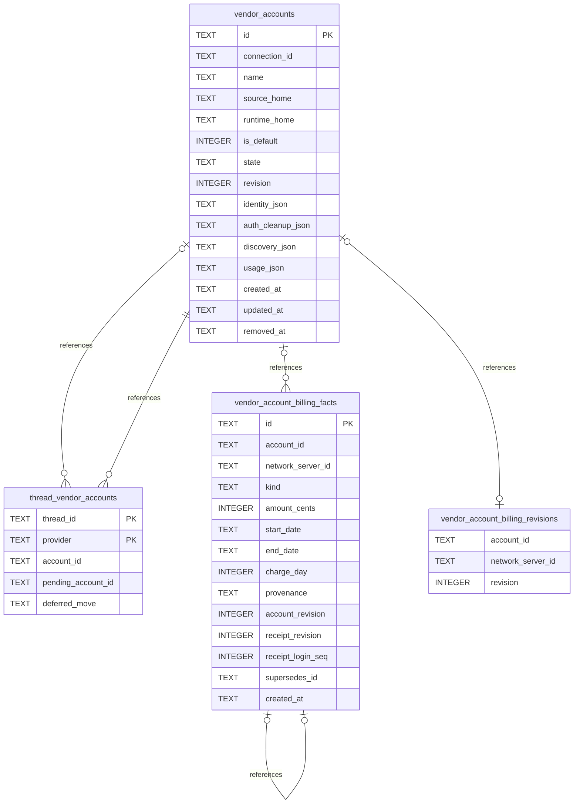

# Vendor Account Schema

Tables in the primary store created by `backend/infra/vendor_account_schema.py`.

## Tables 1–4

### `thread_vendor_accounts`

| Column | Type | Primary key | NOT NULL | Default | References ||---|---|---|---|---|---|
| `thread_id` | TEXT | Yes | Yes | — | threads.id |
| `provider` | TEXT | Yes | Yes | — | — |
| `account_id` | TEXT | No | Yes | — | vendor_accounts.id |
| `pending_account_id` | TEXT | No | No | — | vendor_accounts.id |
| `deferred_move` | TEXT | No | No | — | — |

Indexes: `sqlite_autoindex_thread_vendor_accounts_1` (thread_id, provider, unique).

### `vendor_account_billing_facts`

| Column | Type | Primary key | NOT NULL | Default | References ||---|---|---|---|---|---|
| `id` | TEXT | Yes | No | — | — |
| `account_id` | TEXT | No | No | — | vendor_accounts.id |
| `network_server_id` | TEXT | No | No | — | network_servers.id |
| `kind` | TEXT | No | Yes | — | — |
| `amount_cents` | INTEGER | No | Yes | — | — |
| `start_date` | TEXT | No | Yes | — | — |
| `end_date` | TEXT | No | Yes | — | — |
| `charge_day` | INTEGER | No | No | — | — |
| `provenance` | TEXT | No | Yes | 'user_recorded' | — |
| `account_revision` | INTEGER | No | No | — | — |
| `receipt_revision` | INTEGER | No | No | — | — |
| `receipt_login_seq` | INTEGER | No | No | — | — |
| `supersedes_id` | TEXT | No | No | — | vendor_account_billing_facts.id |
| `created_at` | TEXT | No | Yes | — | — |

Indexes: `idx_vendor_account_billing_facts_account` (account_id, kind, start_date, end_date, created_at), `idx_vendor_account_billing_facts_server` (network_server_id, kind, start_date, end_date, created_at), `idx_vendor_account_billing_facts_supersedes` (supersedes_id, unique), `sqlite_autoindex_vendor_account_billing_facts_1` (id, unique).

### `vendor_account_billing_revisions`

| Column | Type | Primary key | NOT NULL | Default | References ||---|---|---|---|---|---|
| `account_id` | TEXT | No | No | — | vendor_accounts.id |
| `network_server_id` | TEXT | No | No | — | network_servers.id |
| `revision` | INTEGER | No | Yes | 0 | — |

Indexes: `idx_vendor_account_billing_revisions_account` (account_id, unique), `idx_vendor_account_billing_revisions_server` (network_server_id, unique).

### `vendor_accounts`

| Column | Type | Primary key | NOT NULL | Default | References ||---|---|---|---|---|---|
| `id` | TEXT | Yes | No | — | — |
| `connection_id` | TEXT | No | Yes | — | connections.id |
| `name` | TEXT | No | Yes | — | — |
| `source_home` | TEXT | No | No | — | — |
| `runtime_home` | TEXT | No | No | — | — |
| `is_default` | INTEGER | No | Yes | 0 | — |
| `state` | TEXT | No | Yes | 'signed_out' | — |
| `revision` | INTEGER | No | Yes | 0 | — |
| `identity_json` | TEXT | No | Yes | '{}' | — |
| `auth_cleanup_json` | TEXT | No | No | — | — |
| `discovery_json` | TEXT | No | No | — | — |
| `usage_json` | TEXT | No | No | — | — |
| `created_at` | TEXT | No | Yes | — | — |
| `updated_at` | TEXT | No | Yes | — | — |
| `removed_at` | TEXT | No | No | — | — |

Indexes: `idx_vendor_accounts_connection` (connection_id, created_at), `idx_vendor_accounts_default` (connection_id, unique), `sqlite_autoindex_vendor_accounts_1` (id, unique).
