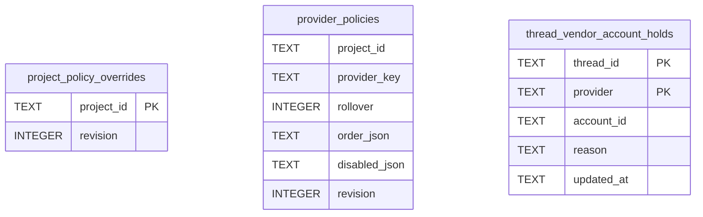

# Vendor Policy Schema

Tables in the primary store created by `backend/infra/vendor_policy_schema.py`.

## Tables 1–3

### `project_policy_overrides`

| Column | Type | Primary key | NOT NULL | Default | References ||---|---|---|---|---|---|
| `project_id` | TEXT | Yes | No | — | projects.id |
| `revision` | INTEGER | No | Yes | 0 | — |

Indexes: `sqlite_autoindex_project_policy_overrides_1` (project_id, unique).

### `provider_policies`

| Column | Type | Primary key | NOT NULL | Default | References ||---|---|---|---|---|---|
| `project_id` | TEXT | No | No | — | projects.id |
| `provider_key` | TEXT | No | Yes | — | — |
| `rollover` | INTEGER | No | Yes | 0 | — |
| `order_json` | TEXT | No | No | — | — |
| `disabled_json` | TEXT | No | Yes | '[]' | — |
| `revision` | INTEGER | No | Yes | 0 | — |

Indexes: `idx_provider_policies_scope` (expression, provider_key, unique).

### `thread_vendor_account_holds`

| Column | Type | Primary key | NOT NULL | Default | References ||---|---|---|---|---|---|
| `thread_id` | TEXT | Yes | Yes | — | threads.id |
| `provider` | TEXT | Yes | Yes | — | — |
| `account_id` | TEXT | No | No | — | vendor_accounts.id |
| `reason` | TEXT | No | Yes | — | — |
| `updated_at` | TEXT | No | Yes | — | — |

Indexes: `sqlite_autoindex_thread_vendor_account_holds_1` (thread_id, provider, unique).
