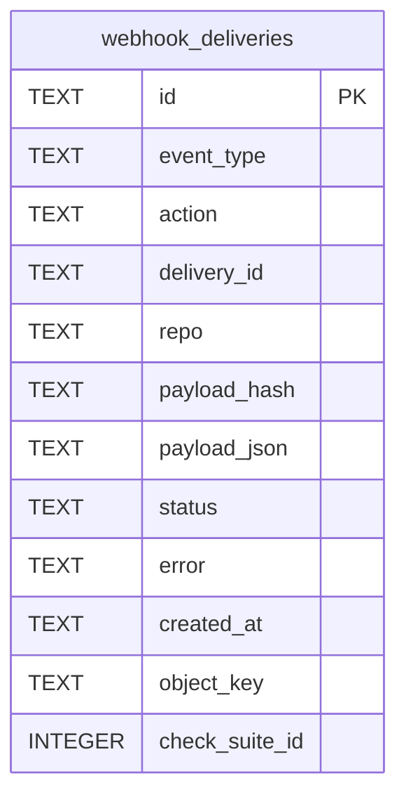

# Webhook Delivery Schema

Tables in the primary store created by `backend/infra/webhook_delivery_schema.py`.

## Tables 1–1

### `webhook_deliveries`

| Column | Type | Primary key | NOT NULL | Default | References ||---|---|---|---|---|---|
| `id` | TEXT | Yes | No | — | — |
| `event_type` | TEXT | No | Yes | — | — |
| `action` | TEXT | No | No | — | — |
| `delivery_id` | TEXT | No | Yes | — | — |
| `repo` | TEXT | No | No | — | — |
| `payload_hash` | TEXT | No | Yes | — | — |
| `payload_json` | TEXT | No | No | — | — |
| `status` | TEXT | No | Yes | 'received' | — |
| `error` | TEXT | No | No | — | — |
| `created_at` | TEXT | No | Yes | — | — |
| `object_key` | TEXT | No | No | — | — |
| `check_suite_id` | INTEGER | No | No | — | — |

Indexes: `idx_webhook_deliveries_check_suite` (check_suite_id, created_at), `idx_webhook_deliveries_event` (event_type, created_at), `idx_webhook_deliveries_object_key` (object_key, unique), `idx_webhook_deliveries_status` (status, created_at), `sqlite_autoindex_webhook_deliveries_1` (id, unique), `sqlite_autoindex_webhook_deliveries_2` (delivery_id, unique).
