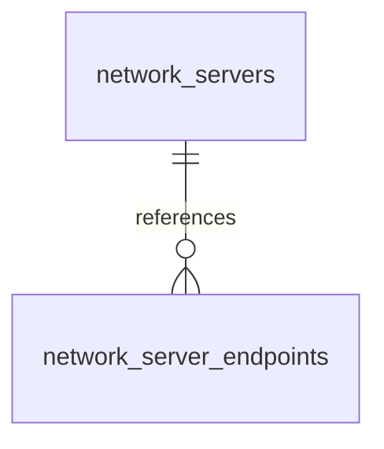

# Providers and runtime

These tables store provider, model, server and runtime process data.

## Relationships

## Tables

### `limit_observations`

Source: `backend/infra/limit_history_schema.py`.

| Column | Type | Primary key | NOT NULL | Default | References |
|---|---|---|---|---|---|
| `id` | INTEGER | Yes | No | — | — |
| `account_id` | TEXT | No | Yes | — | vendor_accounts.id |
| `window_key` | TEXT | No | Yes | — | — |
| `window_kind` | TEXT | No | Yes | — | — |
| `used_percent` | REAL | No | No | — | — |
| `resets_at` | TEXT | No | No | — | — |
| `source` | TEXT | No | Yes | — | — |
| `observed_at` | TEXT | No | Yes | — | — |

Indexes: `idx_limit_observations_window` (account_id, window_key, observed_at).

### `managed_process_handles`

Source: `backend/infra/managed_process_schema.py`.

| Column | Type | Primary key | NOT NULL | Default | References |
|---|---|---|---|---|---|
| `handle` | TEXT | Yes | No | — | — |
| `thread_id` | TEXT | No | Yes | — | — |
| `turn_id` | TEXT | No | Yes | — | — |
| `lease_id` | TEXT | No | No | — | — |
| `description` | TEXT | No | No | — | — |
| `long_running` | INTEGER | No | Yes | 0 | — |
| `pid` | INTEGER | No | Yes | — | — |
| `pgid` | INTEGER | No | Yes | — | — |
| `creation_fingerprint` | TEXT | No | Yes | — | — |
| `log_path` | TEXT | No | Yes | — | — |
| `state` | TEXT | No | Yes | — | — |
| `outcome` | TEXT | No | No | — | — |
| `reason` | TEXT | No | No | — | — |
| `exit_code` | INTEGER | No | No | — | — |
| `started_at` | TEXT | No | Yes | — | — |
| `last_output_at` | TEXT | No | No | — | — |
| `stalled_since` | TEXT | No | No | — | — |
| `stall_after_seconds` | INTEGER | No | No | — | — |
| `max_lifetime_seconds` | INTEGER | No | No | — | — |
| `ended_at` | TEXT | No | No | — | — |
| `log_truncated` | INTEGER | No | Yes | 0 | — |
| `event_message_id` | TEXT | No | No | — | — |

Indexes: `idx_managed_process_handles_state` (state), `idx_managed_process_handles_thread` (thread_id, started_at), `sqlite_autoindex_managed_process_handles_1` (handle, unique).

### `managed_process_retirements`

Source: `backend/infra/managed_process_schema.py`.

| Column | Type | Primary key | NOT NULL | Default | References |
|---|---|---|---|---|---|
| `handle` | TEXT | Yes | No | — | — |
| `thread_id` | TEXT | No | Yes | — | — |
| `head_log_name` | TEXT | No | Yes | — | — |
| `tail_log_name` | TEXT | No | No | — | — |
| `staged_at` | TEXT | No | Yes | — | — |

Indexes: `sqlite_autoindex_managed_process_retirements_1` (handle, unique).

### `model_profiles`

Source: `backend/infra/schema.py`.

| Column | Type | Primary key | NOT NULL | Default | References |
|---|---|---|---|---|---|
| `model_id` | TEXT | Yes | No | — | — |
| `context_window` | INTEGER | No | No | — | — |
| `temperature` | REAL | No | No | — | — |
| `parallel_slots` | INTEGER | No | No | 1 | — |
| `reasoning_budget` | INTEGER | No | No | -1 | — |
| `flash_attention` | INTEGER | No | No | 1 | — |
| `custom_args` | TEXT | No | No | — | — |
| `max_tokens` | INTEGER | No | No | — | — |
| `updated_at` | TEXT | No | No | — | — |

Indexes: `sqlite_autoindex_model_profiles_1` (model_id, unique).

### `models`

Source: `backend/infra/schema.py`.

| Column | Type | Primary key | NOT NULL | Default | References |
|---|---|---|---|---|---|
| `id` | TEXT | Yes | No | — | — |
| `harness` | TEXT | No | Yes | 'native' | — |
| `provider` | TEXT | No | Yes | — | — |
| `provider_model_id` | TEXT | No | Yes | — | — |
| `litellm_model` | TEXT | No | Yes | — | — |
| `display_name` | TEXT | No | Yes | — | — |
| `alias` | TEXT | No | No | — | — |
| `description` | TEXT | No | No | — | — |
| `backend` | TEXT | No | Yes | 'api' | — |
| `source` | TEXT | No | Yes | 'seed' | — |
| `enabled` | INTEGER | No | Yes | 1 | — |
| `available` | INTEGER | No | Yes | 1 | — |
| `context_window` | INTEGER | No | No | — | — |
| `supports_vision` | INTEGER | No | No | 0 | — |
| `supports_tools` | INTEGER | No | No | 1 | — |
| `supports_reasoning` | INTEGER | No | No | 0 | — |
| `default_temperature` | REAL | No | No | 0.3 | — |
| `default_max_tokens` | INTEGER | No | No | 8192 | — |
| `metadata_json` | TEXT | No | No | — | — |
| `last_used_at` | TEXT | No | No | — | — |
| `runtime_state` | TEXT | No | No | 'idle' | — |
| `last_error` | TEXT | No | No | — | — |
| `load_started_at` | TEXT | No | No | — | — |
| `load_completed_at` | TEXT | No | No | — | — |
| `inference_overrides` | TEXT | No | No | — | — |
| `load_overrides` | TEXT | No | No | — | — |
| `estimated_memory_gb` | REAL | No | No | — | — |
| `discovered_at` | TEXT | No | No | — | — |
| `last_seen_at` | TEXT | No | No | — | — |
| `created_at` | TEXT | No | Yes | — | — |
| `updated_at` | TEXT | No | Yes | — | — |

Indexes: `sqlite_autoindex_models_1` (id, unique), `sqlite_autoindex_models_2` (provider, provider_model_id, unique).

### `network_server_endpoints`

Source: `backend/infra/schema.py`.

| Column | Type | Primary key | NOT NULL | Default | References |
|---|---|---|---|---|---|
| `id` | TEXT | Yes | No | — | — |
| `server_id` | TEXT | No | Yes | — | network_servers.id |
| `host` | TEXT | No | Yes | — | — |
| `kind` | TEXT | No | Yes | — | — |
| `last_ok_at` | TEXT | No | No | — | — |
| `last_latency_ms` | INTEGER | No | No | — | — |
| `created_at` | TEXT | No | Yes | — | — |
| `updated_at` | TEXT | No | Yes | — | — |

Indexes: `idx_network_endpoints_server` (server_id), `sqlite_autoindex_network_server_endpoints_1` (id, unique), `sqlite_autoindex_network_server_endpoints_2` (server_id, host, unique).

### `network_servers`

Source: `backend/infra/schema.py`.

| Column | Type | Primary key | NOT NULL | Default | References |
|---|---|---|---|---|---|
| `id` | TEXT | Yes | No | — | — |
| `provider` | TEXT | No | Yes | 'omlx' | — |
| `kind` | TEXT | No | Yes | 'managed' | — |
| `dialect` | TEXT | No | No | — | — |
| `instance_id` | TEXT | No | Yes | — | — |
| `machine_id` | TEXT | No | No | — | — |
| `instance_name` | TEXT | No | Yes | — | — |
| `port` | INTEGER | No | Yes | — | — |
| `status` | TEXT | No | Yes | 'offline' | — |
| `source` | TEXT | No | No | 'manual' | — |
| `latency_ms` | INTEGER | No | No | — | — |
| `memory_total_mb` | INTEGER | No | No | — | — |
| `memory_used_mb` | INTEGER | No | No | — | — |
| `gpu_info` | TEXT | No | No | — | — |
| `metadata_json` | TEXT | No | No | — | — |
| `last_seen_at` | TEXT | No | Yes | — | — |
| `created_at` | TEXT | No | Yes | — | — |
| `updated_at` | TEXT | No | Yes | — | — |

Indexes: `idx_network_servers_provider` (provider, status), `sqlite_autoindex_network_servers_1` (id, unique), `sqlite_autoindex_network_servers_2` (provider, instance_id, unique).

### `provider_availability`

Source: `backend/infra/provider_availability_schema.py`.

| Column | Type | Primary key | NOT NULL | Default | References |
|---|---|---|---|---|---|
| `harness` | TEXT | Yes | Yes | — | — |
| `provider` | TEXT | Yes | Yes | — | — |
| `account_scope` | TEXT | Yes | Yes | — | — |
| `status` | TEXT | No | Yes | — | — |
| `observed_at` | TEXT | No | Yes | — | — |
| `reset_at` | TEXT | No | No | — | — |
| `source` | TEXT | No | Yes | — | — |
| `evidence_rank` | INTEGER | No | Yes | — | — |
| `evidence_json` | TEXT | No | Yes | — | — |
| `expires_at` | TEXT | No | Yes | — | — |
| `updated_at` | TEXT | No | Yes | — | — |

Indexes: `sqlite_autoindex_provider_availability_1` (harness, provider, account_scope, unique).

### `restart_wake_registrations`

Source: `backend/infra/schema.py`.

| Column | Type | Primary key | NOT NULL | Default | References |
|---|---|---|---|---|---|
| `id` | TEXT | Yes | No | — | — |
| `thread_id` | TEXT | No | Yes | — | — |
| `reason` | TEXT | No | No | — | — |
| `status` | TEXT | No | Yes | 'pending' | — |
| `registered_at` | TEXT | No | Yes | — | — |
| `drained_at` | TEXT | No | No | — | — |
| `operation_id` | TEXT | No | No | — | — |
| `turn_id` | TEXT | No | No | — | — |

Indexes: `idx_restart_registrations_status` (status), `idx_restart_registrations_turn` (operation_id, turn_id, status), `sqlite_autoindex_restart_wake_registrations_1` (id, unique).

### `self_restart_requests`

Source: `backend/infra/schema.py`.

| Column | Type | Primary key | NOT NULL | Default | References |
|---|---|---|---|---|---|
| `id` | TEXT | Yes | No | — | — |
| `requester_thread_id` | TEXT | No | No | — | — |
| `requester_user` | TEXT | No | No | — | — |
| `from_sha` | TEXT | No | No | — | — |
| `deployed_sha` | TEXT | No | No | — | — |
| `branch` | TEXT | No | No | — | — |
| `reason` | TEXT | No | No | — | — |
| `status` | TEXT | No | Yes | 'in_flight' | — |
| `requested_at` | TEXT | No | Yes | — | — |
| `settled_at` | TEXT | No | No | — | — |
| `phase` | TEXT | No | No | — | — |
| `cutoff_at` | TEXT | No | No | — | — |
| `updated_at` | TEXT | No | No | — | — |
| `error` | TEXT | No | No | — | — |
| `kind` | TEXT | No | No | — | — |
| `trigger` | TEXT | No | No | — | — |
| `target_version` | TEXT | No | No | — | — |
| `drain_total` | INTEGER | No | No | — | — |
| `changes` | TEXT | No | No | — | — |
| `outcome_seen_at` | TEXT | No | No | — | — |
| `failure_code` | TEXT | No | No | — | — |
| `failure_detail` | TEXT | No | No | — | — |
| `conductor_told_at` | TEXT | No | No | — | — |

Indexes: `idx_self_restart_requests_status` (status), `idx_self_restart_requests_update_attempts` (kind, requested_at), `sqlite_autoindex_self_restart_requests_1` (id, unique).
