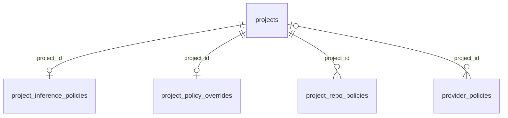

# Settings and policy

These tables store projects, settings and policies.

## Relationships

## Tables

### `project_inference_policies`

Source: `backend/infra/project_policy_schema.py`.

| Column | Type | Primary key | NOT NULL | Default | References |
|---|---|---|---|---|---|
| `project_id` | TEXT | Yes | No | — | projects.id |
| `cloud_models_off` | INTEGER | No | Yes | 0 | — |

Indexes: `sqlite_autoindex_project_inference_policies_1` (project_id, unique).

### `project_policy_overrides`

Source: `backend/infra/vendor_policy_schema.py`.

| Column | Type | Primary key | NOT NULL | Default | References |
|---|---|---|---|---|---|
| `project_id` | TEXT | Yes | No | — | projects.id |
| `revision` | INTEGER | No | Yes | 0 | — |

Indexes: `sqlite_autoindex_project_policy_overrides_1` (project_id, unique).

### `project_repo_policies`

Source: `backend/infra/project_policy_schema.py`.

| Column | Type | Primary key | NOT NULL | Default | References |
|---|---|---|---|---|---|
| `project_id` | TEXT | Yes | Yes | — | projects.id |
| `repo_name` | TEXT | Yes | Yes | — | — |
| `repo_path` | TEXT | No | Yes | — | — |
| `pinned_branch` | TEXT | No | No | — | — |
| `protect_base_checkout` | INTEGER | No | Yes | 1 | — |

Indexes: `sqlite_autoindex_project_repo_policies_1` (project_id, repo_name, unique).

### `projects`

Source: `backend/infra/schema.py`.

| Column | Type | Primary key | NOT NULL | Default | References |
|---|---|---|---|---|---|
| `id` | TEXT | Yes | No | — | — |
| `name` | TEXT | No | Yes | — | — |
| `path` | TEXT | No | No | — | — |
| `description` | TEXT | No | No | — | — |
| `status` | TEXT | No | No | 'active' | — |
| `accent_color` | TEXT | No | No | — | — |
| `doc_roots` | TEXT | No | No | — | — |
| `bootloader_files` | TEXT | No | No | — | — |
| `conductor_thread_id` | TEXT | No | No | — | — |
| `created_at` | TEXT | No | Yes | — | — |
| `updated_at` | TEXT | No | Yes | — | — |

Indexes: `idx_projects_status` (status), `sqlite_autoindex_projects_1` (id, unique), `sqlite_autoindex_projects_2` (name, unique).

### `provider_policies`

Source: `backend/infra/vendor_policy_schema.py`.

| Column | Type | Primary key | NOT NULL | Default | References |
|---|---|---|---|---|---|
| `project_id` | TEXT | No | No | — | projects.id |
| `provider_key` | TEXT | No | Yes | — | — |
| `rollover` | INTEGER | No | Yes | 0 | — |
| `order_json` | TEXT | No | No | — | — |
| `disabled_json` | TEXT | No | Yes | '[]' | — |
| `revision` | INTEGER | No | Yes | 0 | — |

Indexes: `idx_provider_policies_scope` (expression, provider_key, unique).

### `reviewer_gate_approval`

Source: `backend/infra/reviewer_gate_schema.py`.

| Column | Type | Primary key | NOT NULL | Default | References |
|---|---|---|---|---|---|
| `pr_key` | TEXT | Yes | No | — | — |
| `approved_sha` | TEXT | No | Yes | — | — |

Indexes: `sqlite_autoindex_reviewer_gate_approval_1` (pr_key, unique).

### `reviewer_gate_pending`

Source: `backend/infra/reviewer_gate_schema.py`.

| Column | Type | Primary key | NOT NULL | Default | References |
|---|---|---|---|---|---|
| `pr_key` | TEXT | Yes | Yes | — | — |
| `head_sha` | TEXT | Yes | Yes | — | — |
| `internal_event` | TEXT | No | Yes | — | — |

Indexes: `sqlite_autoindex_reviewer_gate_pending_1` (pr_key, head_sha, unique).

### `reviewer_gate_state`

Source: `backend/infra/reviewer_gate_schema.py`.

| Column | Type | Primary key | NOT NULL | Default | References |
|---|---|---|---|---|---|
| `pr_key` | TEXT | Yes | No | — | — |
| `reviewed_sha` | TEXT | No | Yes | — | — |

Indexes: `sqlite_autoindex_reviewer_gate_state_1` (pr_key, unique).

### `settings`

Source: `backend/infra/settings_schema.py`.

| Column | Type | Primary key | NOT NULL | Default | References |
|---|---|---|---|---|---|
| `key` | TEXT | Yes | No | — | — |
| `value` | TEXT | No | Yes | — | — |
| `updated_at` | TEXT | No | Yes | — | — |

Indexes: `sqlite_autoindex_settings_1` (key, unique).

### `thread_vendor_account_holds`

Source: `backend/infra/vendor_policy_schema.py`.

| Column | Type | Primary key | NOT NULL | Default | References |
|---|---|---|---|---|---|
| `thread_id` | TEXT | Yes | Yes | — | threads.id |
| `provider` | TEXT | Yes | Yes | — | — |
| `account_id` | TEXT | No | No | — | vendor_accounts.id |
| `reason` | TEXT | No | Yes | — | — |
| `updated_at` | TEXT | No | Yes | — | — |

Indexes: `sqlite_autoindex_thread_vendor_account_holds_1` (thread_id, provider, unique).
