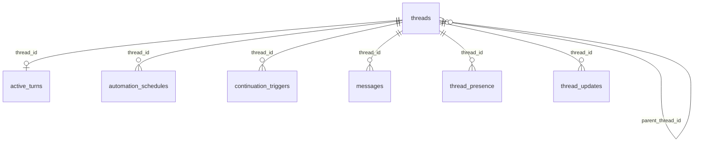

# Threads and messages

These tables store threads, turns, messages, presence and related updates.

## Relationships

## Tables

### `active_turns`

Source: `backend/infra/schema.py`.

| Column | Type | Primary key | NOT NULL | Default | References |
|---|---|---|---|---|---|
| `turn_order` | INTEGER | Yes | No | — | — |
| `id` | TEXT | No | Yes | — | — |
| `thread_id` | TEXT | No | Yes | — | threads.id |
| `execution_epoch` | INTEGER | No | Yes | — | — |
| `model` | TEXT | No | Yes | — | — |
| `status` | TEXT | No | Yes | 'running' | — |
| `started_at` | TEXT | No | Yes | — | — |
| `ended_at` | TEXT | No | No | — | — |
| `error` | TEXT | No | No | — | — |
| `boot_epoch` | TEXT | No | Yes | — | — |
| `retry_at` | TEXT | No | No | — | — |
| `idle_checkpoint_pending` | INTEGER | No | Yes | 0 | — |
| `usage_receipts_json` | TEXT | No | Yes | '{}' | — |
| `plan_id` | TEXT | No | No | — | — |
| `plan_node_id` | TEXT | No | No | — | — |
| `plan_attempt_id` | TEXT | No | No | — | — |
| `plan_commitment_id` | TEXT | No | No | — | — |
| `plan_usage_role` | TEXT | No | No | — | — |
| `vendor_account_id` | TEXT | No | No | — | vendor_accounts.id |
| `context_manifest_id` | TEXT | No | No | — | — |
| `guidance_load_status` | TEXT | No | No | — | — |
| `context_manifest_status` | TEXT | No | No | 'unbound' | — |

Indexes: `idx_active_turns_idle_checkpoint_due` (ended_at, turn_order), `idx_active_turns_one_active` (thread_id, unique), `idx_active_turns_pending_usage` (turn_order), `idx_active_turns_plan_node` (plan_node_id), `idx_active_turns_session` (thread_id), `idx_active_turns_status` (status), `idx_active_turns_thread_status` (thread_id, status), `sqlite_autoindex_active_turns_1` (id, unique).

### `automation_schedules`

Source: `backend/infra/continuation_schema.py`.

| Column | Type | Primary key | NOT NULL | Default | References |
|---|---|---|---|---|---|
| `id` | TEXT | Yes | No | — | — |
| `thread_id` | TEXT | No | Yes | — | threads.id |
| `scope_id` | TEXT | No | Yes | — | — |
| `kind` | TEXT | No | Yes | — | — |
| `spec` | TEXT | No | Yes | — | — |
| `next_run_at` | TEXT | No | No | — | — |
| `last_run_at` | TEXT | No | No | — | — |
| `runs` | INTEGER | No | Yes | 0 | — |
| `max_runs` | INTEGER | No | Yes | — | — |
| `state` | TEXT | No | Yes | 'active' | — |
| `payload_json` | TEXT | No | No | — | — |
| `created_by_actor` | TEXT | No | Yes | — | — |
| `created_at` | TEXT | No | Yes | — | — |
| `updated_at` | TEXT | No | Yes | — | — |
| `script_path` | TEXT | No | No | — | — |
| `script_sha256` | TEXT | No | No | — | — |
| `timeout_seconds` | INTEGER | No | No | — | — |
| `running_since` | TEXT | No | No | — | — |
| `last_status` | TEXT | No | No | — | — |
| `last_error` | TEXT | No | No | — | — |
| `noted_at` | TEXT | No | No | — | — |
| `last_measures` | TEXT | No | No | — | — |

Indexes: `idx_automation_schedules_due` (state, next_run_at), `idx_automation_schedules_scope` (scope_id, next_run_at), `sqlite_autoindex_automation_schedules_1` (id, unique).

### `chat_comment_answers`

Source: `backend/infra/chat_comment_schema.py`.

| Column | Type | Primary key | NOT NULL | Default | References |
|---|---|---|---|---|---|
| `thread_id` | TEXT | No | Yes | — | — |
| `user_message_id` | TEXT | No | Yes | — | — |
| `cid` | TEXT | Yes | Yes | — | — |
| `assistant_message_id` | TEXT | Yes | Yes | — | — |
| `answered_at` | TEXT | No | Yes | — | — |

Indexes: `idx_chat_comment_answers_comment` (thread_id, user_message_id, cid), `idx_chat_comment_answers_thread_time` (thread_id, answered_at), `sqlite_autoindex_chat_comment_answers_1` (assistant_message_id, cid, unique).

### `chat_comment_views`

Source: `backend/infra/chat_comment_schema.py`.

| Column | Type | Primary key | NOT NULL | Default | References |
|---|---|---|---|---|---|
| `user_id` | TEXT | Yes | Yes | — | — |
| `user_message_id` | TEXT | Yes | Yes | — | — |
| `cid` | TEXT | Yes | Yes | — | — |
| `seen_at` | TEXT | No | Yes | — | — |

Indexes: `sqlite_autoindex_chat_comment_views_1` (user_message_id, cid, user_id, unique).

### `chat_comments`

Source: `backend/infra/chat_comment_schema.py`.

| Column | Type | Primary key | NOT NULL | Default | References |
|---|---|---|---|---|---|
| `thread_id` | TEXT | No | Yes | — | — |
| `target_message_id` | TEXT | No | Yes | — | — |
| `user_message_id` | TEXT | Yes | Yes | — | — |
| `cid` | TEXT | Yes | Yes | — | — |
| `created_at` | TEXT | No | Yes | — | — |
| `root_user_message_id` | TEXT | No | No | — | — |
| `root_cid` | TEXT | No | No | — | — |

Indexes: `idx_chat_comments_target` (thread_id, target_message_id), `sqlite_autoindex_chat_comments_1` (user_message_id, cid, unique).

### `continuation_triggers`

Source: `backend/infra/continuation_schema.py`.

| Column | Type | Primary key | NOT NULL | Default | References |
|---|---|---|---|---|---|
| `id` | TEXT | Yes | No | — | — |
| `kind` | TEXT | No | Yes | — | — |
| `thread_id` | TEXT | No | Yes | — | threads.id |
| `scope_id` | TEXT | No | Yes | — | — |
| `subject_id` | TEXT | No | No | — | — |
| `dedupe_key` | TEXT | No | Yes | — | — |
| `idempotency_key` | TEXT | No | No | — | — |
| `state` | TEXT | No | Yes | 'pending' | — |
| `reason` | TEXT | No | No | — | — |
| `attempt` | INTEGER | No | Yes | 0 | — |
| `deferrals` | INTEGER | No | Yes | 0 | — |
| `cost_estimate_usd` | REAL | No | Yes | 0.0 | — |
| `next_attempt_at` | TEXT | No | No | — | — |
| `created_at` | TEXT | No | Yes | — | — |
| `updated_at` | TEXT | No | Yes | — | — |
| `dispatched_at` | TEXT | No | No | — | — |
| `settled_at` | TEXT | No | No | — | — |

Indexes: `idx_continuation_triggers_live` (dedupe_key, unique), `idx_continuation_triggers_scope` (scope_id, created_at), `idx_continuation_triggers_state` (state, next_attempt_at), `sqlite_autoindex_continuation_triggers_1` (id, unique).

### `held_replies`

Source: `backend/infra/held_replies_schema.py`.

| Column | Type | Primary key | NOT NULL | Default | References |
|---|---|---|---|---|---|
| `id` | TEXT | Yes | No | — | — |
| `user_id` | TEXT | No | Yes | — | — |
| `sender_thread_id` | TEXT | No | Yes | — | — |
| `recipient_thread_id` | TEXT | No | Yes | — | — |
| `recipient_title` | TEXT | No | No | — | — |
| `text` | TEXT | No | Yes | — | — |
| `via` | TEXT | No | Yes | — | — |
| `plan_node_id` | TEXT | No | No | — | — |
| `idempotency_key` | TEXT | No | No | — | — |
| `state` | TEXT | No | Yes | 'held' | — |
| `error` | TEXT | No | No | — | — |
| `error_ref` | TEXT | No | No | — | — |
| `created_at` | TEXT | No | Yes | — | — |
| `decided_at` | TEXT | No | No | — | — |

Indexes: `idx_held_replies_idempotency` (sender_thread_id, recipient_thread_id, idempotency_key, unique), `idx_held_replies_user_state` (user_id, state, created_at), `sqlite_autoindex_held_replies_1` (id, unique).

### `messages`

Source: `backend/infra/message_schema.py`.

| Column | Type | Primary key | NOT NULL | Default | References |
|---|---|---|---|---|---|
| `id` | TEXT | Yes | No | — | — |
| `thread_id` | TEXT | No | Yes | — | threads.id |
| `role` | TEXT | No | Yes | — | — |
| `content` | TEXT | No | Yes | — | — |
| `metadata` | TEXT | No | No | — | — |
| `created_at` | TEXT | No | Yes | — | — |
| `delivery_state` | TEXT | No | Yes | 'delivered' | — |
| `delivery_error` | TEXT | No | No | — | — |
| `delivery_revision` | INTEGER | No | Yes | 1 | — |
| `input_order` | INTEGER | No | No | — | — |
| `delivery_intent` | TEXT | No | No | — | — |
| `target_execution_epoch` | INTEGER | No | No | — | — |
| `target_model` | TEXT | No | No | — | — |
| `continuation_condition` | TEXT | No | No | — | — |
| `delivery_options` | TEXT | No | No | — | — |
| `delivery_attempt_id` | TEXT | No | No | — | — |
| `write_started_at` | TEXT | No | No | — | — |
| `write_outcome` | TEXT | No | No | — | — |
| `active_turn_id` | TEXT | No | No | — | — |
| `next_attempt_at` | TEXT | No | No | — | — |
| `seq` | INTEGER | No | No | — | — |

Indexes: `idx_measurement_human_messages_time` (thread_id, created_at, id), `idx_messages_active_turn` (active_turn_id, input_order), `idx_messages_checkpoint_hold` (thread_id, target_model, target_execution_epoch), `idx_messages_delivery_attempt` (delivery_attempt_id, input_order), `idx_messages_id_session` (id, thread_id, unique), `idx_messages_input_order` (thread_id, input_order, unique), `idx_messages_installed_boundaries` (thread_id, seq, id), `idx_messages_queued_inputs` (thread_id, delivery_state, input_order), `idx_messages_session` (thread_id, created_at), `idx_messages_session_seq` (thread_id, seq, unique), `idx_messages_tool_lineage` (thread_id, role, expression, expression), `idx_messages_turn_calls` (thread_id, role, expression), `sqlite_autoindex_messages_1` (id, unique).

### `presence_focus_rollup`

Source: `backend/infra/presence_rollup_schema.py`.

| Column | Type | Primary key | NOT NULL | Default | References |
|---|---|---|---|---|---|
| `user_id` | TEXT | Yes | Yes | — | — |
| `bucket` | TEXT | Yes | Yes | — | — |
| `set_id` | INTEGER | Yes | Yes | — | — |
| `seconds` | REAL | No | Yes | — | — |

Indexes: `sqlite_autoindex_presence_focus_rollup_1` (user_id, bucket, set_id, unique).

### `presence_focus_rollup_state`

Source: `backend/infra/presence_rollup_schema.py`.

| Column | Type | Primary key | NOT NULL | Default | References |
|---|---|---|---|---|---|
| `id` | INTEGER | Yes | No | — | — |
| `definition` | TEXT | No | Yes | — | — |
| `built_through` | TEXT | No | Yes | — | — |

Indexes: None.

### `presence_focus_set_members`

Source: `backend/infra/presence_rollup_schema.py`.

| Column | Type | Primary key | NOT NULL | Default | References |
|---|---|---|---|---|---|
| `set_id` | INTEGER | No | Yes | — | — |
| `thread_id` | TEXT | No | No | — | — |
| `project_id` | TEXT | No | No | — | — |

Indexes: `idx_presence_focus_set_members_set` (set_id).

### `presence_focus_sets`

Source: `backend/infra/presence_rollup_schema.py`.

| Column | Type | Primary key | NOT NULL | Default | References |
|---|---|---|---|---|---|
| `id` | INTEGER | Yes | No | — | — |
| `signature` | TEXT | No | Yes | — | — |

Indexes: `sqlite_autoindex_presence_focus_sets_1` (signature, unique).

### `presence_visits`

Source: `backend/infra/presence_schema.py`.

| Column | Type | Primary key | NOT NULL | Default | References |
|---|---|---|---|---|---|
| `id` | INTEGER | Yes | No | — | — |
| `user_id` | TEXT | No | Yes | — | — |
| `surface` | TEXT | No | Yes | — | — |
| `thread_id` | TEXT | No | No | — | — |
| `project_id` | TEXT | No | No | — | — |
| `object_id` | TEXT | No | No | — | — |
| `entered_at` | TEXT | No | Yes | — | — |
| `exited_at` | TEXT | No | Yes | — | — |
| `seconds` | INTEGER | No | Yes | — | — |
| `sessions` | INTEGER | No | Yes | — | — |
| `exit_reason` | TEXT | No | Yes | — | — |
| `focus_spans` | TEXT | No | No | — | — |

Indexes: `idx_presence_visits_thread` (thread_id, entered_at), `idx_presence_visits_user_time` (user_id, entered_at).

### `thread_presence`

Source: `backend/infra/presence_schema.py`.

| Column | Type | Primary key | NOT NULL | Default | References |
|---|---|---|---|---|---|
| `user_id` | TEXT | Yes | Yes | — | — |
| `thread_id` | TEXT | Yes | Yes | — | threads.id |
| `present` | INTEGER | No | Yes | 0 | — |
| `last_entered_at` | TEXT | No | Yes | — | — |
| `last_exited_at` | TEXT | No | No | — | — |
| `previous_entered_at` | TEXT | No | No | — | — |
| `exit_pending_at` | TEXT | No | No | — | — |
| `exit_pending_since` | TEXT | No | No | — | — |
| `exit_pending_reason` | TEXT | No | No | — | — |
| `last_confirmed_at` | TEXT | No | Yes | — | — |
| `turn_order_at_exit` | INTEGER | No | No | — | — |
| `away_seconds` | INTEGER | No | No | — | — |
| `turns_while_away` | INTEGER | No | No | — | — |
| `updated_at` | TEXT | No | Yes | — | — |
| `marked_read_at` | TEXT | No | No | — | — |
| `marked_unread_at` | TEXT | No | No | — | — |
| `focus_spans` | TEXT | No | No | — | — |
| `focus_since` | TEXT | No | No | — | — |

Indexes: `idx_thread_presence_thread` (thread_id), `sqlite_autoindex_thread_presence_1` (user_id, thread_id, unique).

### `thread_updates`

Source: `backend/infra/thread_updates_schema.py`.

| Column | Type | Primary key | NOT NULL | Default | References |
|---|---|---|---|---|---|
| `id` | INTEGER | Yes | No | — | — |
| `thread_id` | TEXT | No | Yes | — | threads.id |
| `kind` | TEXT | No | Yes | — | — |
| `source_kind` | TEXT | No | Yes | — | — |
| `source_id` | TEXT | No | Yes | — | — |
| `node_id` | TEXT | No | No | — | — |
| `title` | TEXT | No | No | — | — |
| `after_seq` | INTEGER | No | Yes | — | — |
| `created_at` | TEXT | No | Yes | — | — |

Indexes: `idx_thread_updates_node` (node_id, id), `idx_thread_updates_thread_seq` (thread_id, after_seq), `idx_thread_updates_thread_time` (thread_id, created_at), `sqlite_autoindex_thread_updates_1` (source_kind, source_id, unique).

### `threads`

Source: `backend/infra/schema.py`.

| Column | Type | Primary key | NOT NULL | Default | References |
|---|---|---|---|---|---|
| `id` | TEXT | Yes | No | — | — |
| `user_id` | TEXT | No | Yes | — | — |
| `profile` | TEXT | No | No | 'personal' | — |
| `title` | TEXT | No | No | 'New Chat' | — |
| `model` | TEXT | No | No | — | — |
| `reasoning_effort` | TEXT | No | No | — | — |
| `created_at` | TEXT | No | Yes | — | — |
| `updated_at` | TEXT | No | Yes | — | — |
| `last_auto_retry_at` | TEXT | No | No | — | — |
| `project_id` | TEXT | No | No | — | projects.id |
| `lifecycle_state` | TEXT | No | No | 'active' | — |
| `dormant_at` | TEXT | No | No | — | — |
| `archived_at` | TEXT | No | No | — | — |
| `archived_reason` | TEXT | No | No | — | — |
| `purged_at` | TEXT | No | No | — | — |
| `pinned` | INTEGER | No | No | 0 | — |
| `parent_thread_id` | TEXT | No | No | — | threads.id |
| `spawned_by` | TEXT | No | No | — | threads.id |
| `local_only` | INTEGER | No | Yes | 0 | — |
| `confinement` | TEXT | No | No | — | — |
| `confined_read_dirs` | TEXT | No | No | — | — |
| `bootloader_files` | TEXT | No | No | — | — |
| `pending_compaction_trigger` | TEXT | No | No | — | — |
| `pending_compaction_detail` | TEXT | No | No | — | — |
| `agent_enabled` | INTEGER | No | No | 0 | — |
| `agent_responsibility` | TEXT | No | No | — | — |
| `agent_paths` | TEXT | No | No | — | — |
| `agent_domains` | TEXT | No | No | — | — |
| `agent_status` | TEXT | No | No | 'active' | — |
| `agent_notes` | TEXT | No | No | — | — |
| `agent_roster_updated_at` | TEXT | No | Yes | '1970-01-01T00:00:00+00:00' | — |
| `history_epoch` | INTEGER | No | Yes | 0 | — |
| `runtime_context_epoch` | INTEGER | No | Yes | 0 | — |
| `last_context_change_seq` | INTEGER | No | Yes | 0 | — |
| `execution_epoch` | INTEGER | No | Yes | 0 | — |
| `pending_model` | TEXT | No | No | — | — |
| `pending_execution_epoch` | INTEGER | No | No | — | — |
| `switch_after_input_order` | INTEGER | No | No | — | — |
| `switch_operation_id` | TEXT | No | No | — | — |
| `switch_status` | TEXT | No | No | — | — |
| `switch_error` | TEXT | No | No | — | — |
| `switch_requested_at` | TEXT | No | No | — | — |
| `switch_actor_kind` | TEXT | No | No | — | — |
| `switch_actor_id` | TEXT | No | No | — | — |
| `switch_reason` | TEXT | No | No | — | — |
| `switch_checkpoint_choice` | TEXT | No | No | — | — |
| `next_input_order` | INTEGER | No | Yes | 1 | — |
| `next_message_seq` | INTEGER | No | Yes | 1 | — |

Indexes: `idx_measurement_thread_children` (parent_thread_id, user_id), `idx_threads_user` (user_id, updated_at), `sqlite_autoindex_threads_1` (id, unique).
