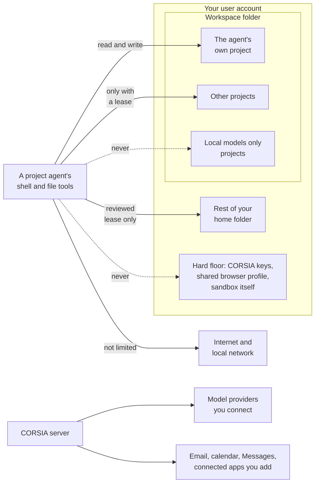

# Security model

CORSIA runs agents on your own computer, as your own user account, with real tools: a shell, file tools, the web, your email and the apps you connect. This section says what those agents can reach, what stops them, how strong each stop is, and where it doesn't hold. These pages were last checked against the code at commit `7a8c55d84`: every change since the previous check at `43a8c7780` was reviewed and the claims it touched were rechecked, but not every other claim was re-verified. "At this commit" on these pages means `7a8c55d84`. The claims about separating projects and about the workspace's Git history were rechecked later, at `0c56132e6`, from the code and its tests. On each pull request, CI checks only that the files and links a page cites still exist, not that what the page says is still true, so a later change can leave a page out of date. The pages name the source files so you can check.

**Who this is for:** someone deciding whether to let agents work on their machine. If you only read one page, read this one and [Known limits](limits.md).

## The boundaries

The arrows show an agent in a project. The CORSIA agent's shell and file tools also reach ordinary projects without a lease; it is fenced only from projects set to Local models only, and only while its own chat isn't Local only ([Agent sandbox](agent-sandbox.md#projects)).

- **Workspace:** the folder CORSIA works in (by default `~/corsia`). It holds every project, shared files, context and each chat's working files.
- **Project:** a folder inside the workspace. Projects organize work and settings, and they are a **partial** boundary: an agent in a project can't read or write another project's folder or its repositories, from its shell or with its file tools (the CORSIA agent's exception is above; on Linux, a folder that doesn't exist yet isn't fenced from the shell until it exists), but its chat tools can still read another project's chats. See [Agent sandbox](agent-sandbox.md#projects).
- **Local only** and **Local models only:** the chat setting and the project setting that keep a chat or a whole project on local models. A project set to Local models only is also closed to other agents' shells and file tools, even under a lease; the one exception is a CORSIA agent whose own chat is Local only. See [Data and privacy](data-and-privacy.md#local-only).
- **Thread:** one chat with one agent. Each thread has its own working folder inside the workspace.
- **Lease:** a short, reviewed grant that lets one agent run commands outside the workspace. See [Host access](host-access.md).
- **Hard floor:** paths no leased command can read or write. It stops direct access only; see [What no lease opens](host-access.md#what-no-lease-opens) for the indirect route.

## How strong each control is

Every control in these pages carries one of these labels.

| Label | Meaning |
|---|---|
| **Operating system** | The OS refuses it, whatever the agent tries. Holds unless the OS sandbox itself has a flaw. |
| **CORSIA code** | Deterministic checks in CORSIA's code. Holds unless the code has a bug or is bypassed. |
| **Model judgment** | A model decides. It can be fooled, and it can be wrong in both directions. |
| **Your setting** | Only applies if you turn it on. |

## What an agent can and can't do by default

This is the default on macOS: no lease, no settings changed. Linux differences are in [Agent sandbox](agent-sandbox.md).

| Action | Default | Strength |
|---|---|---|
| Read and write its own project, the workspace's shared files and its own working folder | Allowed | — |
| Read or write another project's folder or registered repositories, from the shell or with file tools (`read_file`, `write_file` and the rest) | Refused for an agent in a project; a lease opens it to leased shell commands and file-tool calls unless that project is set to Local models only. The CORSIA agent is fenced less (see above) | Operating system for the shell, CORSIA code for file tools |
| Read the workspace's own Git history | Refused to every agent's shell and file tools, even under a lease; agents use the workspace history and commit tools instead | Operating system for the shell, CORSIA code for file tools |
| Read another project's chats | Allowed | — |
| Read the rest of your home folder (Documents, Desktop, Downloads, Pictures, shell history, Mail, browser data, `~/.ssh` keys, Keychains, cloud credential folders) | Refused | Operating system |
| Read some tool settings in your home folder: `~/.gitconfig`, most of `~/.config` (your GitHub CLI login in `~/.config/gh` included; if an agents' GitHub account is set up, that account's token instead), `~/.cache`, `~/.npm`, `~/.cargo`; and system files such as `/etc` | Allowed | — |
| Write outside the workspace and registered repositories | Refused, except temporary folders (`/tmp`, the system temp folder that holds per-chat package caches), `~/.ssh/known_hosts`, and some developer-tool caches Agent Safehouse allows (such as `~/.npm`, `~/.cargo`, `~/.rustup`) | Operating system |
| Run `sudo`, `su`, `shutdown`, disk erase, `curl … \| sh` | Refused | CORSIA code, and the OS for the privileged binaries |
| Use your loaded SSH keys through the SSH agent (for `git push`, `ssh`) | Allowed | — |
| Make any outbound network request | Allowed, not limited | — |
| Read a provider API key CORSIA stores | Refused; values are not in the shell's environment | Operating system and CORSIA code |
| See a credential that sits in a workspace file | Masked in most cases; see [Secrets](secrets.md) for what masking misses | CORSIA code |
| Send an email, calendar invite or text message | Only an unchanged open draft, and only after you write in the chat after its last change; it doesn't check what your reply said. The `google_workspace` tool can share a file or email a calendar event's guests without this check | CORSIA code |
| Anything outside the workspace that the rows above refuse | Only through a lease | CORSIA code to require it; Model judgment to review it |
| Approve its own lease | No; you approve, or the reviewer model does when Auto-approve is on ([Host access](host-access.md)) | CORSIA code; Model judgment under Auto-approve |

## The limits that matter most

The full list, with what to do about each, is in [Known limits](limits.md).

1. **Agents run as you.** The sandbox narrows what a command can touch; it is not a container or a separate user. A sandbox flaw exposes what your user can reach.
2. **Projects are only partly separated.** A project agent's shell and file tools are fenced out of other projects, and the CORSIA agent is fenced less (see above), but chat tools are not fenced. Keep work that must stay apart in separate workspaces, each with its own CORSIA install and state.
3. **Outbound network access is not limited.** An agent that reads something it shouldn't can send it anywhere.
4. **Reviewers are not a defense against a tricked agent.** The models that review lease requests and leased commands assume the agent is yours and working on your task. They are instructed to block a short list: secret exposure, changes to access controls, needless destruction, and commands plainly outside the approved purpose. A model can miss those. They will usually allow a plausible request to read your ordinary personal files.
5. **Prompt injection is not solved.** Email is screened by a local model and labelled; web pages, attachments, text messages and tool results are not screened. Labelled content still reaches the agent.
6. **Stored keys are not encrypted.** They sit in a file only your user can read, and no agent command can open it directly, even under a lease. Anything running as your user outside the sandbox can read them, and that includes something a leased command left behind to run later.
7. **No outside security audit.** Nobody outside the project has tested these controls.

## Pages

| Page | Answers |
|---|---|
| [Threat model](threat-model.md) | What we protect, from whom, what we assume, what's out of scope |
| [Agent sandbox](agent-sandbox.md) | How shell commands and file tools are confined on macOS and Linux |
| [Host access](host-access.md) | Leases: request, review, approval, per-command checks, expiry |
| [Secrets](secrets.md) | Where keys live, who can read them, masking and what it misses |
| [Data and privacy](data-and-privacy.md) | What leaves your machine, to whom and when; Local only; telemetry; data at rest; removal |
| [Network](network.md) | What listens, on which address; phones and other devices; outbound access |
| [Untrusted content](untrusted-content.md) | Prompt injection: email screening, isolated workers, what isn't screened |
| [Connected apps](connected-apps.md) | Connected apps, Google and Microsoft sign-in, Google Docs and Drive, Messages, GitHub, sending, the shared browser |
| [Accounts and access](accounts-and-access.md) | Sign-in, sessions, tokens, what scope does and doesn't guarantee |
| [Supply chain](supply-chain.md) | Dependency pinning, signing, updates, the skill library |
| [Audit](audit.md) | What's recorded, where, for how long, how to read it |
| [Known limits](limits.md) | Every known limit, its consequence and what to do |
| [FAQ](faq.md) | The hard questions, answered |

Before reporting a vulnerability, read [`SECURITY.md`](../../SECURITY.md).
