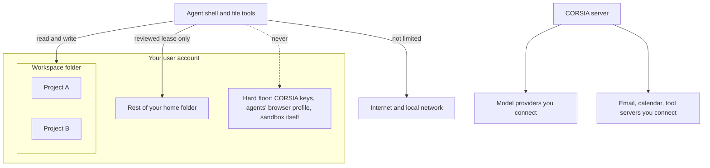

# Security model

CORSIA runs agents on your own computer, as your own user account, with real tools: a shell, file tools, the web, your email and the apps you connect. This section says what those agents can reach, what stops them, how strong each stop is, and where it doesn't hold. Everything here describes the code at the commit you are reading; the pages name the source files so you can check.

**Who this is for:** someone deciding whether to let agents work on their machine. If you only read one page, read this one and [Known limits](limits.md).

## The boundaries

- **Workspace:** the folder CORSIA works in (by default `~/corsia`). It holds every project, shared files, context and each conversation's working files.
- **Project:** a folder inside the workspace. Projects organize work and settings; they are **not** a security boundary. An agent in one project can read and change every other project in the same workspace.
- **Thread:** one conversation with one agent. Each thread has its own working folder inside the workspace.
- **Lease:** a short, reviewed grant that lets one agent run commands outside the workspace. See [Host access](host-access.md).
- **Hard floor:** paths no lease ever opens.

## How strong each control is

Every control in these pages carries one of these labels.

| Label | Meaning |
|---|---|
| **Operating system** | The OS refuses it, whatever the agent tries. Holds unless the OS sandbox itself has a flaw. |
| **CORSIA code** | Deterministic checks in CORSIA's code. Holds unless the code has a bug or is bypassed. |
| **Model judgment** | A model decides. It can be fooled, and it can be wrong in both directions. |
| **Your setting** | Only applies if you turn it on. |

## What an agent can and can't do by default

This is the default on macOS: no lease, no settings changed. Linux differences are in [Agent sandbox](agent-sandbox.md).

| Action | Default | Strength |
|---|---|---|
| Read and write anything in the workspace, every project included | Allowed | — |
| Read the rest of your home folder (Documents, Desktop, Downloads, Pictures, shell history, Mail, browser data, `~/.ssh` keys, Keychains, cloud credential folders) | Refused | Operating system |
| Read some tool settings in your home folder: `~/.gitconfig`, most of `~/.config` (your GitHub CLI login in `~/.config/gh` included, unless an agents' GitHub account is set up), `~/.cache`, `~/.npm`, `~/.cargo`; and system files such as `/etc` | Allowed | — |
| Write outside the workspace and registered repositories | Refused | Operating system |
| Run `sudo`, `su`, `shutdown`, disk erase, `curl … \| sh` | Refused | CORSIA code, and the OS for the privileged binaries |
| Use your loaded SSH keys through the SSH agent (for `git push`, `ssh`) | Allowed | — |
| Make any outbound network request | Allowed, not limited | — |
| Read a provider API key CORSIA stores | Refused; values are not in the shell's environment | Operating system and CORSIA code |
| See a credential that sits in a workspace file | Masked in most cases; see [Secrets](secrets.md) for what masking misses | CORSIA code |
| Send an email or calendar invite | Only after you have seen the draft and written back | CORSIA code |
| Reach outside the workspace | Only through a lease | CORSIA code to require it; Model judgment to review it |
| Approve its own lease | No; you approve, or the automatic reviewer if you turned it on | CORSIA code; Model judgment when automatic |

## The limits that matter most

The full list, with what to do about each, is in [Known limits](limits.md).

1. **Agents run as you.** The sandbox narrows what a command can touch; it is not a container or a separate user. A sandbox flaw exposes what your user can reach.
2. **The workspace is the boundary, not the project.** Keep work that must stay apart in separate workspaces, each with its own CORSIA install and state.
3. **Outbound network access is not limited.** An agent that reads something it shouldn't can send it anywhere.
4. **Reviewers are not a defense against a tricked agent.** The models that review lease requests and leased commands assume the agent is yours and working on your task. They stop secret exposure, changes to access controls and needless destruction. They will usually allow a plausible request to read your ordinary personal files.
5. **Prompt injection is not solved.** Email is screened by a local model and labelled; web pages, attachments and tool results are not screened. Labelled content still reaches the agent.
6. **Stored keys are not encrypted.** They sit in a file only your user can read, outside every agent's reach. Anything running as your user outside CORSIA can read them.
7. **No outside security audit.** Nobody outside the project has tested these controls.

## Pages

| Page | Answers |
|---|---|
| [Threat model](threat-model.md) | What we protect, from whom, what we assume, what's out of scope |
| [Agent sandbox](agent-sandbox.md) | How shell commands and file tools are confined on macOS and Linux |
| [Host access](host-access.md) | Leases: request, review, approval, per-command checks, expiry |
| [Secrets](secrets.md) | Where keys live, who can read them, masking and what it misses |
| [Data and privacy](data-and-privacy.md) | What leaves your machine, to whom and when; Local only; telemetry; data at rest; removal |
| [Network](network.md) | What listens, on which address; phones and other devices; outbound access |
| [Untrusted content](untrusted-content.md) | Prompt injection: email screening, isolated workers, what isn't screened |
| [Connected apps](connected-apps.md) | Tool servers, Google and Microsoft sign-in, sending email, the agents' browser |
| [Accounts and access](accounts-and-access.md) | Sign-in, sessions, tokens, what scope does and doesn't guarantee |
| [Supply chain](supply-chain.md) | Dependency pinning, signing, updates, the skill library |
| [Audit](audit.md) | What's recorded, where, for how long, how to read it |
| [Known limits](limits.md) | Every known limit, its consequence and what to do |
| [FAQ](faq.md) | The hard questions, answered |

To report a vulnerability, see [`SECURITY.md`](../../SECURITY.md).
