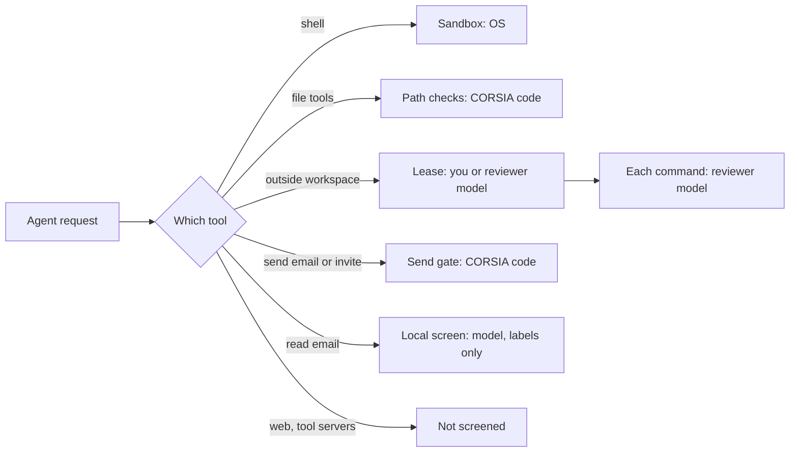

# Threat model

What CORSIA tries to protect, from whom, what it assumes, and what it does not try to defend against. The other pages in this section describe the controls; this page says what they are for.

## What we protect

| Asset | Example |
|---|---|
| Your files outside the workspace | Documents, photos, other code, shell history |
| Your credentials | Provider API keys, SSH private keys, cloud logins, browser cookies, Keychains |
| CORSIA's own controls | The sandbox, its settings, lease approvals, the reviewer, the key store |
| Your accounts' outbound actions | Email you send, invites, posts made in your name |
| Your machine's integrity | System files, startup items, disks |

The workspace itself is **not** in this list as something agents are kept out of. Agents work there; any agent can read and change anything in it. See [Agent sandbox](agent-sandbox.md).

## Who we defend against

| Threat | Example | Main controls |
|---|---|---|
| An agent that makes a mistake | Deletes the wrong folder, runs a destructive command | Sandbox write limits; command refusals; the reviewer on leased commands |
| An agent that has been tricked by content it read | An email or web page tells it to upload your files | Sandbox read limits; email screening; isolated workers; masking. Partial: see [Untrusted content](untrusted-content.md) |
| An agent trying to widen its own access | Asks for a lease it doesn't need, edits the sandbox profile | Leases need approval; the hard floor; the reviewer is instructed to block access-control changes |
| Someone else on your network | A device on the same Wi-Fi | Local-only listening by default; sign-in on every request except a few named routes; see [Network](network.md) |

## What we assume

- **You trust the computer and your user account.** CORSIA runs as you. Anything else running as you (another app, malware) can read what CORSIA stores, including its keys.
- **You trust the model providers you connect** with what you send them. CORSIA sends them your conversations and the files agents read. See [Data and privacy](data-and-privacy.md).
- **You trust the OS sandbox.** On macOS that is Agent Safehouse over the system `sandbox-exec`; on Linux, bubblewrap. A flaw there is a flaw here.
- **One person per install.** The design assumes the person signed in is the owner of the machine and the workspace. See [Accounts and access](accounts-and-access.md).
- **You read what you approve.** A lease you approve without reading, or a draft you reply to without reading, gets no protection from you.

## Out of scope

These are not defended against. Each is stated so you can decide.

- **Malware or another person with access to your user account.** They can read the key store and CORSIA's database directly.
- **Data sent out by an agent with network access.** Outbound traffic is not limited or inspected. If an agent can read something, it can send it somewhere.
- **A determined prompt injection.** How much screening helps is not measured. Nothing guarantees an agent ignores instructions hidden in content.
- **Physical access** to an unlocked machine.
- **Separation between projects or between accounts on one install.** Use separate installs for that.
- **Regulated data.** CORSIA makes no compliance claim (HIPAA, SOC 2 or other). See [FAQ](faq.md).

## Where each control sits

